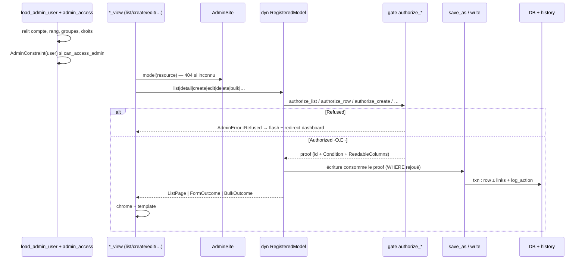
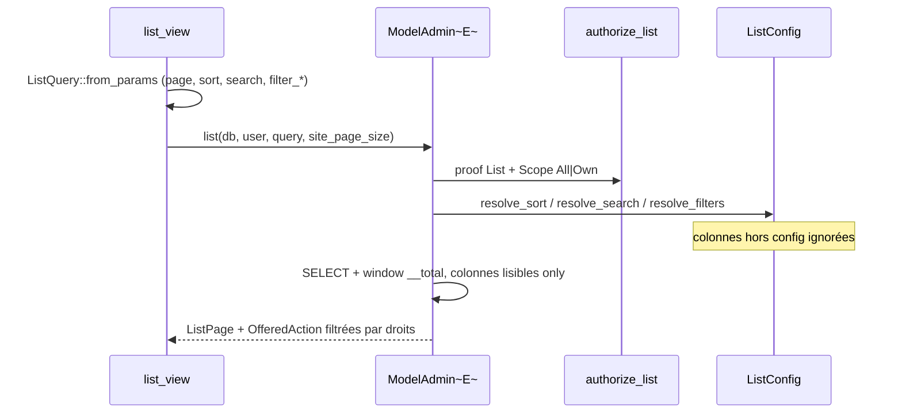
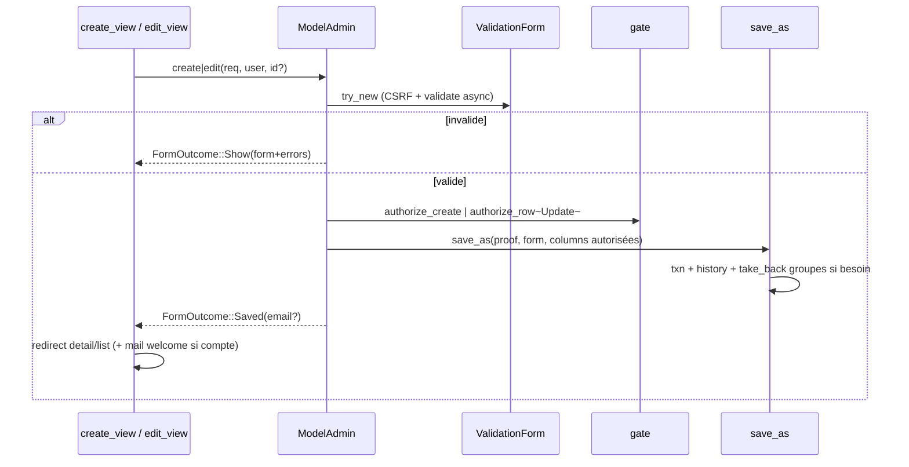
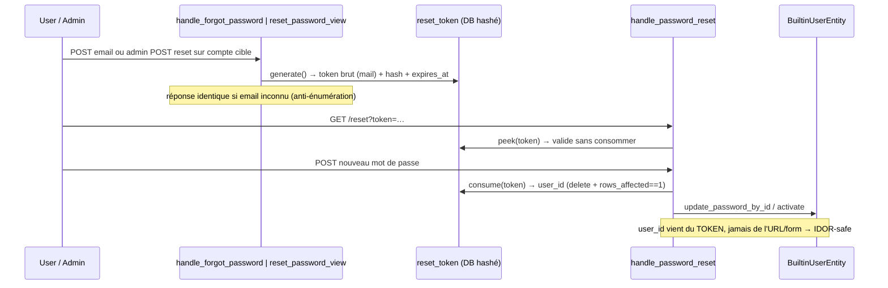
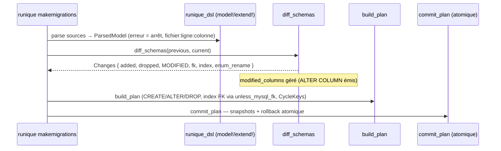

# Flux — Admin CRUD 4.0, reset password, makemigrations

## Admin CRUD (gate + RegisteredModel)

Plus de pattern Command / `ResourceEntry` / closures optionnelles.
Le router pose les layers ; le handler résout le modèle ; **le modèle demande
une preuve au gate** puis lit/écrit sous cette preuve.

[`admin/router/`](../../runique/src/admin/router/),
[`admin/builder/registered.rs`](../../runique/src/admin/builder/registered.rs),
[`auth/gate/`](../../runique/src/auth/gate/)

Source unique d'autorisation : le **gate** (plancher Runique → droits rang/groupes
→ règles métier). Les flags UI (`can_edit`, etc.) sont dérivés de
`CrudAction::resolve` pour l'affichage seulement — le serveur re-vérifie toujours.

Voir [../uml/admin/admin-resource-permissions.md](../uml/admin/admin-resource-permissions.md).

### Liste (détail)

### Écriture (create / edit)

### Bulk

La barre n'envoie que `action=aN` + ids cochés. La valeur écrite est celle de
l'`Action` déclarée dans `ListConfig` — jamais fournie par le client.
Au plus une page de lignes ; tout ou rien via le gate.

## Reset password (IDOR-safe, single-use)

Inchangé dans l'esprit ; déclenchable aussi depuis l'admin
(`ResetPassword` + rang protégé) en plus du flux public forgot/reset.

## makemigrations (diff complet + commit atomique)

Tables framework (`eihwaz_*`) : migrations dédiées dans
`auth/migrations_table.rs`, branchées par le `Migrator` généré du projet —
pas via le DSL `model!{}`.

## Anomalies liées

| ID | Note |
|----|------|
| A1/A2/A3 | architecture 3.x — sans objet en 4.0 |
| Gate TOCTOU | 0 row sur WHERE rejoué → refus, pas d'écriture |
| D3 | index purge/requête à valider sous DB |
| S1 | CSRF forms publics vs sessions anonymes non persistées |
