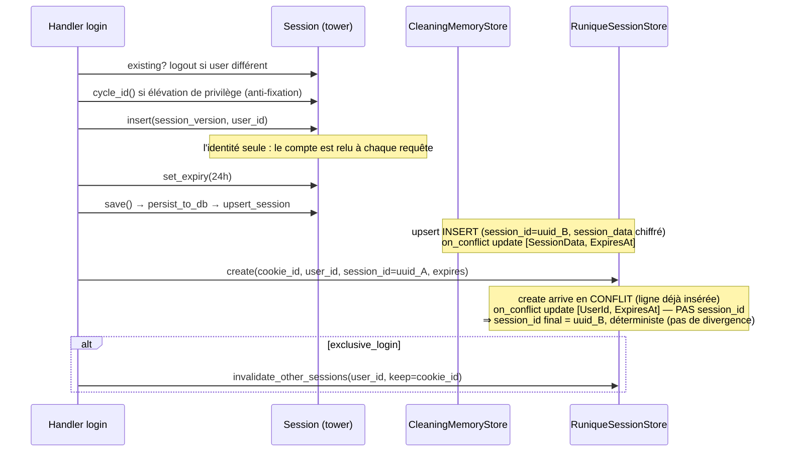
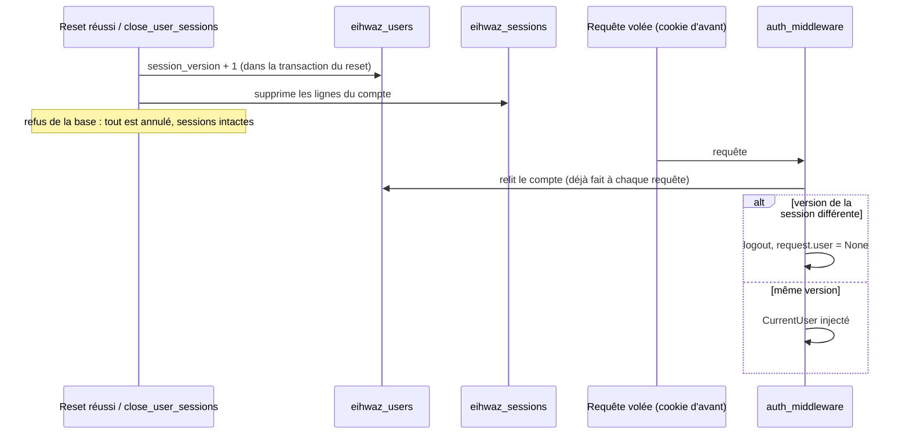
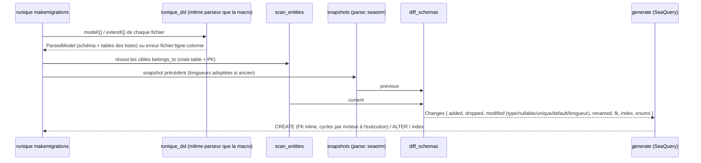

# Flux — Login/session & makemigrations

## Séquence : login authentifié

[`auth/session.rs:192`](../../runique/src/auth/session.rs#L192)

> **Lecture du diagramme** : les deux écritures ont des `on_conflict.update_columns`
> disjoints et **aucune** ne touche `session_id` sur conflit. `upsert` (1ʳᵉ, via `save()`)
> fixe `session_id` ; `create` (2ᵉ) ne fait qu'un UPDATE de `[UserId, ExpiresAt]`. Donc
> `session_id` est cohérent — le seul coût réel est **2 aller-retours DB** (AM2 = perf, pas
> divergence). C'est précisément le genre de faux positif qu'un flux complet (avec les
> `update_columns`) élimine d'emblée.

## Séquence : fermeture des sessions d'un compte

[`auth/session.rs:380`](../../runique/src/auth/session.rs#L380),
[`auth/password.rs`](../../runique/src/auth/password.rs)

`update_password_by_id` n'augmente pas la version : le re-hachage à la connexion passe par lui et
ne doit déconnecter personne. Une session sans version compte pour 0 et prend fin à la première
hausse. `fresh_user` refait la comparaison : si `logout` a échoué, le `user_id` est encore là.

## Séquence : makemigrations (diff)

Chemin réel (3.0.0, 2026-10-06) — le `ModelSchema::diff` du schéma initial n'est pas sur ce
chemin (voir AM1) :

## Anomalies / flux suspects

### ❌ AM1 — FAUX POSITIF (makemigrations gère bien les `ALTER COLUMN`)
La CLI utilise `diff_schemas` ([cli_migration/plan.rs:33](../../runique/src/migration/cli_migration/plan.rs#L33))
qui calcule `modified_columns`. Le `ModelSchema::diff` limité (add/drop) n'est **pas** le
chemin de la CLI. Détecté en traçant le flux jusqu'au vrai `diff` appelé.

### ❌ AM2 — FAUX POSITIF sur la divergence (résidu = perf seulement)
Voir le diagramme ci-dessus : les `on_conflict.update_columns` sont disjoints et **aucun** ne
touche `session_id`. `upsert` (1ʳᵉ) le fixe, `create` (2ᵉ) ne fait qu'un UPDATE
`[UserId, ExpiresAt]`. `session_id` est donc déterministe — pas de divergence. Résidu réel :
**double aller-retour DB** au login (🟡 perf, fusionnable).

### 🟡 AM3 — TTL 24h codé en dur en double — ✅ CORRIGÉ
Une seule durée, `AUTH_SESSION_TTL_SECS`, pour le cookie et la base : réglable par le builder,
24 h par défaut (`DEFAULT_AUTH_SESSION_TTL_SECS`, `auth/session.rs`).

### 🟡 AM4 — `pull_groupes_db` à chaque login + cache mémoire process-local — ✅ CORRIGÉ (2026-10-03)
Cache supprimé. L'état du compte et les droits sont relus en base à chaque requête admin
(`load_admin_user`) ; la session ne garde que l'identité.
