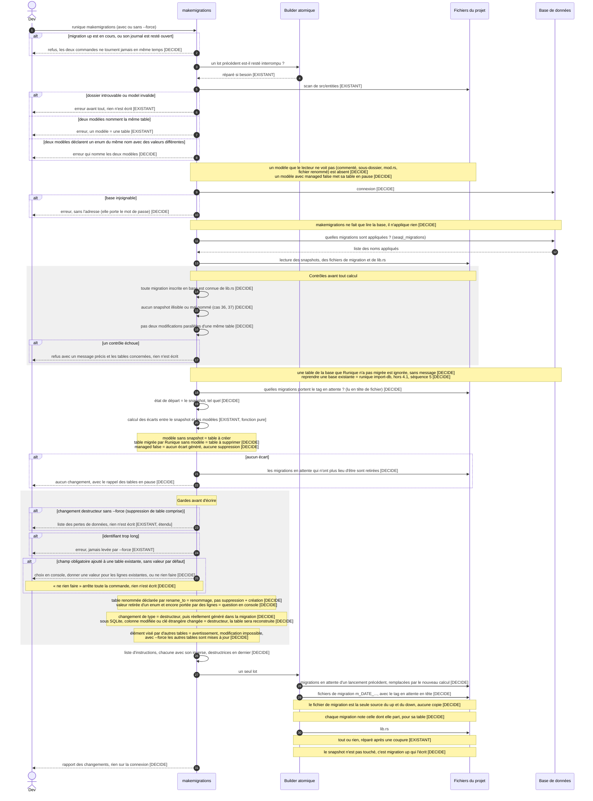
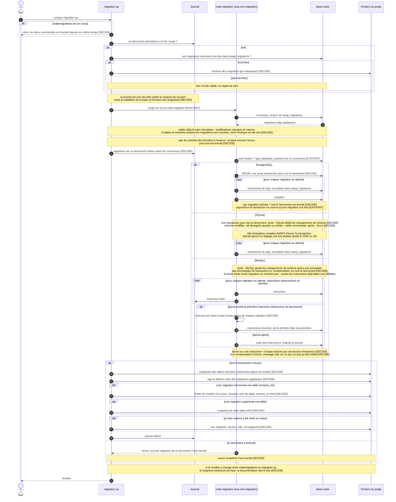
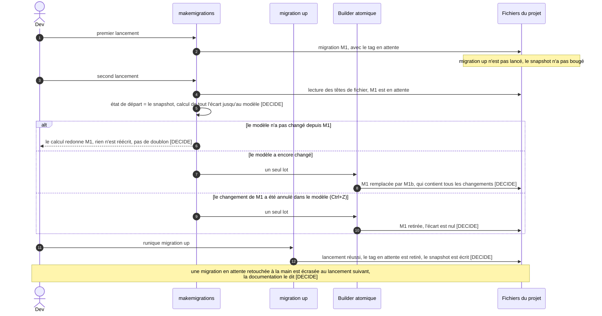
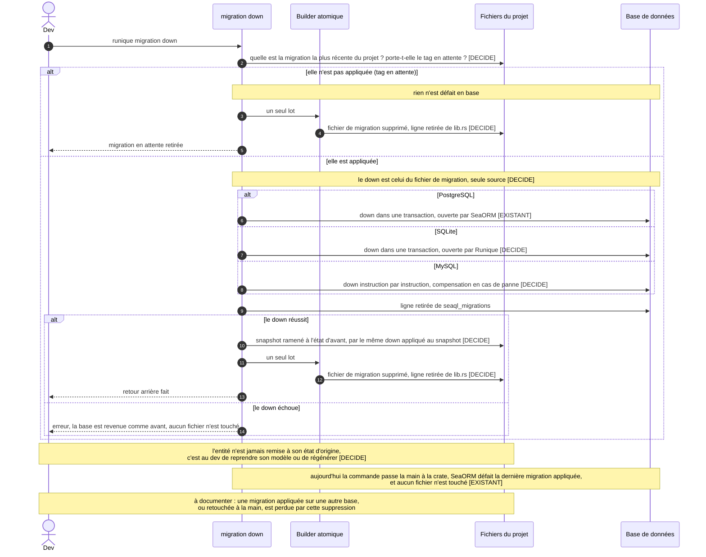
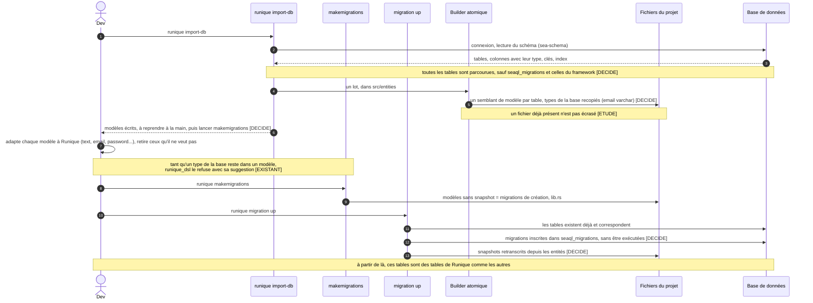

# Flux — makemigrations 4.1 : fonctionnement décidé

Document de travail du chantier makemigrations 4.1, à jour au 2026-11-20. Il décrit le
fonctionnement **visé**, pas le code actuel. Plus aucune question de fonctionnement n'est
ouverte. À remplacer par le flux réel une fois le chantier codé.

| Pour | Fichier |
|---|---|
| une séquence par cas | [makemigrations-4-1-cas.md](makemigrations-4-1-cas.md) |
| les séquences regroupées et le contrôle de chaque combinaison | [makemigrations-4-1-regroupement.md](makemigrations-4-1-regroupement.md) |
| ce qui existe déjà dans le code | [makemigrations-4-1-existant.md](makemigrations-4-1-existant.md) |
| les décisions, une ligne datée chacune | `tableau_suppression_table.md`, section « Décisions prises » |

## Les deux sources (décidé le 2026-11-20)

| Source | Ce que c'est | Écrit par | Quand |
|---|---|---|---|
| **le fichier de migration** | la seule source du `up` et du `down` d'une modification. Il n'en existe aucune copie : pas de dossier `history/` | `makemigrations` | à la génération |
| **le snapshot** | l'état d'une table après un `migration up` ou `down` réussi : la retranscription de l'entité | `migration up` et `down` | à l'application, seulement si elle réussit |

Le dossier `history/`, envisagé les 16 et 19 novembre, est abandonné : il recopiait le `up` et le
`down` que le fichier de migration contient déjà. C'est la raison pour laquelle l'ancien dossier
`applied/` avait été retiré à la 3.0.

## Les règles de fond

| Règle | Source |
|---|---|
| un modèle = une table, seule source de vérité ; deux modèles pour la même table = erreur | Sébastien, 2026-11-19 |
| `makemigrations` lit la base et écrit des fichiers ; il n'applique jamais rien | Sébastien, 2026-11-19 |
| `makemigrations` exige une base ; base injoignable = erreur | Sébastien, 2026-11-19 |
| Runique ne voit que les tables passées par ses migrations ; les autres sont ignorées. Pour reprendre une base existante, une commande à part | Sébastien, 2026-11-19 |
| une migration sortie de `seaql_migrations` n'a plus sa place dans `lib.rs` | Sébastien, 2026-11-19 |
| sur un `down`, Runique ne touche pas aux entités ; sur un `up`, il peut | Sébastien, 2026-11-19 |
| 4.1 = tout `makemigrations`, sans le plusieurs-à-plusieurs ; 4.2 = le plusieurs-à-plusieurs ; `runique import-db` (reprise d'une base existante) en 4.2 ou 4.3 | Sébastien, 2026-11-19 |
| le code propre à un moteur vit dans son fichier, sous sa feature : `db/engine/` avec `postgres.rs`, `mysql.rs`, `sqlite.rs` et un contrat commun ; l'enum du moteur a ses variantes sous feature | Sébastien, 2026-11-20 |
| une migration générée porte un tag « en attente » en tête de fichier ; relancé, `makemigrations` repart du snapshot et la remplace, il n'empile pas | Sébastien, 2026-11-20 |
| `migration up` est en tout ou rien sur le lancement entier ; chaque `down` est encapsulé lui aussi, selon le moteur | Sébastien, 2026-11-20 |
| `makemigrations` et `migration up` ne tournent jamais en même temps | Sébastien, 2026-11-20 |
| un élément destructeur passe par `--force`, qui l'écrit dans le fichier de migration : le dev en accepte les conséquences | Sébastien, 2026-11-20 |

## Vue d'ensemble (découpage de Sébastien)

| Ligne | Contenu | Séquence | Questions ouvertes |
|---|---|---|---|
| 0. Savoir où en est la base | connexion, migrations appliquées, contrôles, migrations en attente (tag) | 1, 3 | — |
| 1. Comparer | écarts entre le snapshot et les modèles | 1 | — |
| 2. Générer | migrations et `lib.rs`, en un lot atomique | 1 | — |
| 3a. Restaurer : revenir en arrière | transaction, compensation sous MySQL, `migration down` | 2, 4 | — |
| 3b. Restaurer : reconstruire le projet depuis une base existante | `runique import-db`, **hors 4.1** (4.2 ou 4.3) | 5 | — |

## Légende

| Marque | Sens |
|---|---|
| `[EXISTANT]` | le code le fait déjà |
| `[DECIDE]` | tranché par Sébastien, pas encore codé |
| `[ETUDE]` | étudié par Claude, pas décidé |

## Séquence 1 : `runique makemigrations`

## Séquence 2 : `runique migration up`

Décidé le 2026-11-20 : tout ou rien sur le lancement entier. Si une migration échoue, aucune de
celles du lancement ne reste appliquée.

## Séquence 3 : relancer `makemigrations` avant d'avoir appliqué

Décidé le 2026-11-20. Une migration générée porte un tag « en attente » en tête de fichier.
`makemigrations` n'empile pas : il repart du snapshot, recalcule tout l'écart, et remplace les
migrations en attente. Il n'applique jamais rien.

## Séquence 4 : `runique migration down`

Une seule commande, qui enveloppe SeaORM. Elle vise toujours la migration la plus récente du
projet, appliquée ou non.

## Séquence 5 : `runique import-db`, reprendre une base existante

Décidé le 2026-11-19. **Hors de la 4.1 : prévue en 4.2 ou 4.3.** La reprise n'est pas
déclenchée par `makemigrations` : c'est une commande à part, `runique import-db`. Elle écrit un
semblant de modèle par table, avec les types de la base recopiés tels quels ; `runique_dsl` les
refuse tant que le dev ne les a pas repris à la main. La documentation doit le dire clairement :
le typage est à refaire à la main.

## Questions tranchées

Gardées pour mémoire, avec la réponse retenue. Les sept trous trouvés en regroupant les
séquences sont dans [makemigrations-4-1-regroupement.md](makemigrations-4-1-regroupement.md).

| Q | Question | État |
|---|---|---|
| Q2 | migration générée et pas appliquée | **décidé le 2026-11-20** : elle porte un tag « en attente » ; relancé, `makemigrations` repart du snapshot et la remplace par le nouveau calcul (cumul, sans doublon) ; il n'applique rien |
| Q3 | base qui n'a pas reçu les migrations | **décidé** : le calcul ne dépend plus de la base, il part du snapshot ; ce qui est appliqué ou non se lit au tag |
| Q4 | contrôles sur les données avant d'appliquer | **décidé** : aucun contrôle à l'avance ; la base renvoie l'erreur, puis transaction ou compensation |
| Q5 | SQLite, colonne modifiée ou clé étrangère changée sur une table existante | **décidé** : élément destructeur, bloqué sans `--force` avec le risque expliqué ; la table est reconstruite |
| Q6 | portée de la transaction | **décidé, revu le 2026-11-20** : tout ou rien sur le lancement entier ; une seule transaction pour tout le lancement (PostgreSQL, SQLite si l'essai passe) ; sinon compensation sur tout le lancement (MySQL), avec un message clair sur ce qui n'a pas pu être compensé |
| Q8 | suppression écrite et pas appliquée, puis relance | **décidé** : recalculée à l'identique si le modèle est toujours absent ; retirée si le modèle est revenu |
| Q9 | deux devs sur la même table | **décidé** : refus, avec les tables concernées ; pas de commande de réunion |
| Q10 | table à ne pas toucher, modèle invisible | **décidé** : `managed: false` dans le `meta` pour la pause ; un modèle que le lecteur ne voit pas est absent |
| Q11 | aucun modèle trouvé | **décidé** : pas de cas à part, les tables migrées par Runique et sans modèle sont proposées à la suppression avec `--force` |
| Q12 | renommage de table ou de champ liste | **décidé** : `rename_to` dans le modèle, retiré par Runique une fois le renommage fait |
| Q13 | table déjà là sans inscription à `migration up` | **décidé** : `migration up` rejoue les modifications en interne ; si les tables et colonnes attendues existent en base, il inscrit les migrations à la date du `migration up` ; les types ne sont pas comparés à la base, ils sont contrôlés dans le modèle ; si la base ne correspond qu'en partie, Runique ne fait rien |
| Q14 | table de la base sans modèle, que Runique n'a pas migrée | **décidé** : ignorée sans message par `makemigrations` ; pour la reprendre, `runique import-db` |
| Q15 | reprise : ce qui est écrit | **décidé** : `runique import-db` (4.2 ou 4.3) écrit un semblant de modèle par table, types de la base recopiés ; les migrations viennent ensuite par `makemigrations`, une fois les modèles repris |
| Q16 | reprise : quelles tables | **décidé** : toutes ; le dev retire les modèles qu'il ne veut pas |
| Q17 | reprise : champs que la base ne dit pas | **décidé** : aucun type n'est choisi par Runique ; `runique_dsl` refuse le modèle tant que le dev n'a pas repris chaque champ |
| Q18 | correspondance des types par moteur | **sans objet** en 4.1 : ni la reprise ni `migration up` n'en ont besoin, le typage est contrôlé dans le modèle |
| Q19 | reprise : inscription du point de départ | **décidé** par Q13 et Q15 : c'est `migration up` qui inscrit quand les tables correspondent, sans option à part |
| Q20 | question en console sans personne pour répondre | **décidé** : la commande s'arrête avec une erreur qui explique quoi faire ; la reprise n'en pose plus, c'est une commande à part |
| Q21 | reprise : lot sur deux dossiers | **sans objet** : `runique import-db` n'écrit que dans `src/entities/`, un seul builder suffit |
| Q22 | forme du générateur | **décidé** : liste d'instructions, chacune avec son inverse ; un retour arrière reprend à un rang donné |
| Q23 | type enum PostgreSQL partagé | **décidé** : contrôle à l'exécution avant tout `DROP TYPE`, jamais de cascade ; même nom et valeurs différentes = erreur |
| Q24 | `makemigrations` sans base | **décidé** : il exige une base, tests sur les trois moteurs par Docker |
| Q25 | valeur retirée d'un enum | **décidé** : s'il ne reste aucune ligne avec la valeur, elle est retirée ; sinon question en console pour la valeur de remplacement, et sans choix rien n'est appliqué |
| Q26 | migrations du framework et refus | sans objet depuis Q3 : il n'y a plus de refus général ; leur nom fixe sert toujours à lire leur état |
| Q27 | champ obligatoire ajouté à une table remplie | **décidé** : choix en console (`dialoguer`), donner une valeur ou ne rien faire ; pas de valeur par défaut d'office ; « ne rien faire » arrête toute la commande ; le garde existant pour « facultatif vers obligatoire » est étendu aux colonnes ajoutées |
| Q28 | `migration down` | **décidé** : une seule commande, qui enveloppe SeaORM et vise la migration la plus récente du projet. Pas appliquée : fichier et ligne de `lib.rs` supprimés. Appliquée : `down` du fichier de migration, snapshot ramené par ce même `down`, puis fichier et ligne supprimés. Entités jamais touchées |
| Q29 | savoir ce que le snapshot contient déjà | **décidé** : c'est le tag « en attente » des migrations qui le dit ; aucune marque dans le snapshot |
