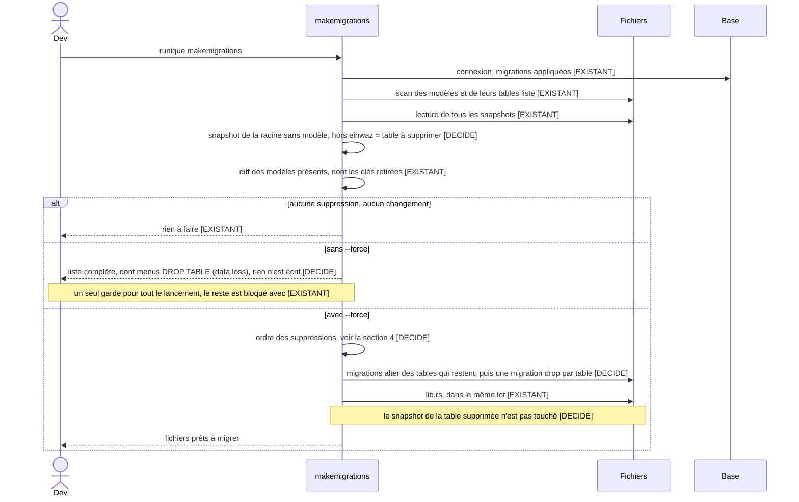
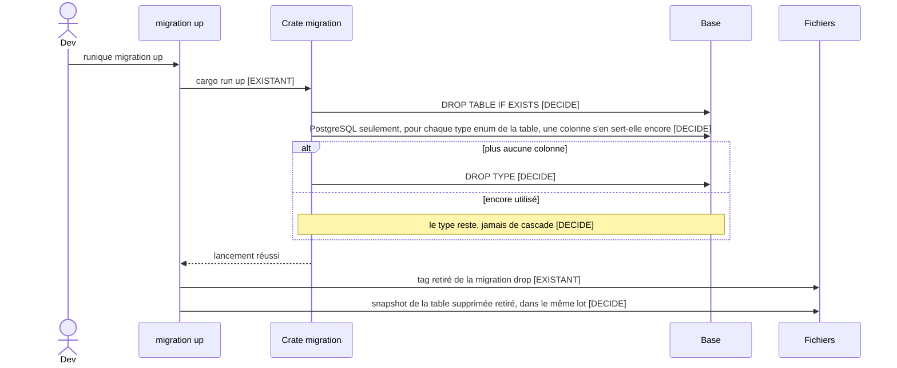

# Flux — makemigrations 4.1 : la suppression de table

Schéma de travail écrit le 2026-11-21, avant de coder la suppression de table. **Codée le même
jour** d'après lui ; les sections 8 et 9 disent ce qui a été écrit et ce qui attend un autre
morceau. Il ne décide
rien : chaque règle renvoie à sa ligne dans
[tableau_suppression_table.md](../../tableau_suppression_table.md) (les 53 cas et la section
« Décisions prises »), et chaque fait de code à son fichier. Ce qui n'a pas pu être vérifié est
marqué comme tel.

Marques : `[EXISTANT]` le code le fait déjà, `[DECIDE]` tranché par Sébastien et pas codé,
`[TESTE]` fait établi le 2026-11-21 sur les vrais moteurs (PostgreSQL 16.15 et MySQL 8.4.13 des
conteneurs de test, SQLite 3.46.1), les commandes et leurs résultats sont au §7.

Participants : `D` le dev, `MM` makemigrations, `UP` migration up, `F` les fichiers du projet,
`DB` la base, `CR` la crate `migration/`.

---

## 1. La règle

Une table est à supprimer quand **son snapshot existe à la racine de `snapshots/` et qu'aucun
modèle scanné ne produit cette table** (cas 4).

| Élément | Source |
|---|---|
| le snapshot est l'état d'une table appliquée, écrit par `migration up` | décision du 2026-11-19, codé le 2026-11-20 |
| donc « snapshot sans modèle » veut dire « table que Runique a migrée et qui n'a plus d'entité » | décision du 2026-11-19, cas 10 et 22 |
| une table de la base que Runique n'a pas migrée n'a pas de snapshot : ignorée, sans message | Q14, 2026-11-19 |
| une table du framework (`eihwaz_*`) n'est jamais supprimée, même avec un snapshot à la racine | cas 35 et 38, 2026-11-20 |
| `snapshots/runique/` (les `extend!{}`) n'entre pas dans cette règle : c'est le cas 48, un autre morceau | cas 35, 48 |

Ce que le scan voit, et dont la règle dépend ([scan.rs](../../runique/src/migration/cli_migration/scan.rs)) :

- les `.rs` du premier niveau de `src/entities/`, sauf `mod.rs` `[EXISTANT]` ;
- un fichier sans `model!{}` est ignoré `[EXISTANT]` ;
- chaque champ liste produit sa table `{table}_{champ}`, rendue avec les tables des modèles
  `[EXISTANT]` ;
- les tables du framework sont écartées du scan `[EXISTANT]`.

Conséquence directe, sans code en plus : un modèle que le lecteur ne voit pas (commenté,
sous-dossier, `mod.rs`, extension changée) est absent, donc sa table est proposée à la
suppression (cas 18 à 21). La mise en pause se demande par `managed: false`, qui est un autre
morceau, pas encore codé.

---

## 2. Les 53 cas, rangés par ce qui les traite

| Cas | Situation | Traité par |
|---|---|---|
| 1, 2 | modèle présent, avec ou sans snapshot | diff et création `[EXISTANT]` |
| 3, 39 | ni modèle ni snapshot | rien, indétectable |
| 4, 5, 6, 9 | modèle retiré, snapshot présent | **la règle** |
| 7, 17 | champ liste retiré, ou changé en champ simple | **la règle**, sur la table `{table}_{champ}` |
| 8 | modèle avec champ liste retiré | **la règle**, deux tables, voir l'ordre |
| 10, 22 | tous les modèles retirés | **la règle**, sans cas à part (2026-11-19) |
| 11, 12 | fichier renommé, ou autre modèle sur le même `table_name` | le modèle existe : diff `[EXISTANT]` |
| 13, 44 | relance avant d'appliquer la suppression | la relance, codée le 2026-11-20, voir §5 |
| 14, 15, 16 | `table_name` ou champ liste renommé sans `rename_to` | **la règle** donne `DROP` + création, bloqués sans `--force`. `rename_to` est un autre morceau |
| 18 à 21 | modèle que le lecteur ne voit pas | **la règle** |
| 23 | mauvais dossier passé à la main | aucun code (2026-11-20) |
| 24, 25 | dossier introuvable, modèle invalide | erreur du scan `[EXISTANT]` |
| 26 | la table supprimée est encore visée par un `belongs_to` | erreur du scan `[EXISTANT]` |
| 27 à 32 | relations | voir l'ordre, §4 |
| 33 | colonnes enum | voir §6 |
| 34, 36, 37 | contenu de `snapshots/` | `snapshot::read_all`, codé le 2026-11-20 |
| 35, 38 | tables du framework | exclues de la règle |
| 40 | snapshot supprimé à la main, modèle présent | création `IF NOT EXISTS` `[EXISTANT]` |
| 41, 42, 43, 47 | `--force` | le garde unique, voir §3 |
| 45 | la table n'existe plus en base | `DROP TABLE IF EXISTS` |
| 46 | `migration down` après la suppression | morceau `migration down`, pas celui-ci |
| 48 | bloc `extend!{}` retiré | autre morceau |
| 49, 50 | coupure, snapshot disparu pendant l'écriture | builder atomique `[EXISTANT]` |
| 51 | droits `eihwaz_*` de la ressource | élagués au démarrage `[EXISTANT]` |
| 52, 53 | historique admin, fichiers `media/` | notés « morceau 2 » dans le tableau : à signaler dans la sortie, plus tard |

---

## 3. `makemigrations`

Le fichier généré, `m{date}_drop_{table}_table.rs` (nom posé dans « La règle proposée » du
tableau) :

| Partie | Contenu | Source |
|---|---|---|
| en-tête | tag « en attente » et ligne `from`, comme toute migration | codé les 20 et 21 |
| `up` | `DROP TABLE IF EXISTS`, puis les types enum de la table, sous condition | cas 45, cas 33 |
| `down` | la table recréée depuis son snapshot, vide | cas 46 : « la table revient vide » |

Le `down` se fabrique avec ce qui existe : le snapshot relu donne un schéma, et
`generate_create_file_in_cycle` sait déjà écrire une création complète (colonnes, clés, index,
types enum).

Ce que la commande ne fait pas : toucher à la base, ou au snapshot (cas 43).

---

## 4. L'ordre

Règle générale : **ce qui vise est retiré avant ce qui est visé**, l'inverse de la création
(cas 30).

| Cas | Situation | Ordre | Marque |
|---|---|---|---|
| 27 | une table qui reste avait un `belongs_to` vers la table supprimée, retiré du modèle | la migration `alter` de la table qui reste (elle retire la clé) passe avant la migration `drop` | `[DECIDE]`, le retrait de clé existe déjà dans le diff |
| 8 | modèle et sa table liste | la table liste d'abord : c'est elle qui vise le modèle | `[DECIDE]` |
| 30 | deux tables supprimées, l'une vise l'autre | celle qui vise d'abord | `[DECIDE]`, « si le flux ne casse rien » |
| 31 | tables supprimées en cycle de clés | la clé qui ferme le cycle est retirée avant, sauf sous SQLite, en réutilisant `cycle_keys` | `[DECIDE]`, « si le flux ne casse rien ». Sous SQLite le flux casse si les tables ont des lignes : voir §7 |
| 28, 29, 32 | la table supprimée vise une table qui reste, une table du framework, ou elle-même | suppression directe, aucun ordre à tenir | règle |
| 26 | une table qui reste la vise encore | pas d'ordre : le scan s'arrête en erreur | `[EXISTANT]` |

Ce qui existe pour ça : `topological_sort_changes`
([ordering.rs](../../runique/src/migration/changes/ordering.rs)) trie les **créations** par
dépendances et place les modifications après ; `cycle_keys`
([plan.rs](../../runique/src/migration/cli_migration/plan.rs)) repère les clés d'un cycle entre
tables créées. Rien ne trie des suppressions aujourd'hui.

Ordre complet d'un lancement, tel qu'il découle des décisions :

1. créations, dans l'ordre des dépendances `[EXISTANT]` ;
2. modifications des tables qui restent, dont les retraits de clé du cas 27 `[EXISTANT]` ;
3. suppressions, dans l'ordre inverse des dépendances `[DECIDE]`.

La décision « instructions destructrices en dernier » (2026-11-16, compensation MySQL) va dans
le même sens : les suppressions de table ferment le lancement.

---

## 5. `migration up`, et la relance

Aujourd'hui `record_applied` ([migrate.rs](../../runique/src/migration/cli_migration/migrate.rs))
retire le tag et **écrit** le snapshot des tables créées ou modifiées. Pour une migration
`drop`, il doit le **retirer** (cas 38 : « seul le snapshot d'une table supprimée est retiré,
quand la suppression est appliquée »). `migration_target`
([paths.rs](../../runique/src/migration/paths.rs)) ne reconnaît que `create`, `alter` et
`extend` : `drop` est à ajouter.

La relance ne demande aucun code propre à la suppression, elle découle de ce qui est codé :

| Cas | Situation | Ce qui se passe |
|---|---|---|
| 13 | relance, le modèle toujours absent | le snapshot est toujours là, le calcul redonne la même suppression, rien n'est réécrit |
| 44 | relance, le modèle est revenu | l'écart est nul, la migration `drop` en attente est retirée avec sa ligne de `lib.rs` |

Les deux reposent sur `replace_waiting`, à condition que le contenu d'une migration `drop` soit
identique d'un calcul à l'autre : il ne doit dépendre que du snapshot, pas de la date.

---

## 6. Les enums (cas 33)

Décision du 2026-11-19 : « avant de supprimer un type enum PostgreSQL, la migration demande à
la base si une colonne l'utilise encore, et le laisse si oui ; jamais de cascade. Règle unique
pour toutes les suppressions de type, celles qui existent et celles à écrire. »

Fait du code : toutes les suppressions de type passent par une seule fonction,
`enum_drop_stmt` ([enums.rs](../../runique/src/migration/generate/enums.rs)), appelée par le
`down` d'une création, le `down` d'une colonne ajoutée et le passage d'une colonne hors d'un
enum. Elle écrit aujourd'hui `DROP TYPE IF EXISTS` sans regarder si une colonne s'en sert.
Mettre le contrôle dans cette fonction l'applique donc partout d'un coup, suppression de table
comprise. La création de type, elle, interroge déjà le catalogue de PostgreSQL par une requête
typée : le même procédé sert ici.

Sous MySQL et SQLite, une colonne enum est un texte : il n'y a aucun type à supprimer
`[EXISTANT]`, le garde `backend == Postgres` est déjà dans le fichier généré.

---

## 7. Par moteur

Tout ce tableau a été essayé le 2026-11-21 : PostgreSQL 16.15 et MySQL 8.4.13 dans les
conteneurs de test (un schéma et une base à part, supprimés ensuite), SQLite 3.46.1 en mémoire
avec les clés étrangères actives, comme sqlx les active.

| Point | PostgreSQL | MySQL | SQLite |
|---|---|---|---|
| `DROP TABLE IF EXISTS` sur une table absente | passe, simple avis `[TESTE]` | passe, simple avis `[TESTE]` | passe `[TESTE]` |
| table visée par la clé d'une autre, **sans aucune ligne** | refus : « other objects depend on it » `[TESTE]` | refus : erreur 3730 `[TESTE]` | **passe** `[TESTE]` |
| même cas, avec des lignes qui la visent | refus, le même | refus, le même | refus : « FOREIGN KEY constraint failed » `[TESTE]` |
| même cas, la clé est en `ON DELETE CASCADE` | refus, le même | refus, le même | **passe, et les lignes de l'autre table sont supprimées** `[TESTE]` |
| clé retirée d'abord, puis la table | passe `[TESTE]` | passe `[TESTE]` | retrait de clé impossible, voir plus bas |
| celle qui vise d'abord, puis l'autre | passe `[TESTE]` | passe `[TESTE]` | passe `[TESTE]` |
| cycle de clés, les deux tables ont des lignes | refus tant que la clé fermante est là ; retirée, puis les deux tables : passe `[TESTE]` | idem `[TESTE]` | refus dans les deux ordres, transaction ou non ; passe seulement **clés étrangères coupées avant la transaction** `[TESTE]` |
| type enum encore utilisé, `DROP TYPE` | refus sans `CASCADE` `[TESTE]` | sans objet | sans objet |
| suppression de table puis annulation de la transaction | la table revient (essai du 2026-11-20) | **la table ne revient pas** `[TESTE]` | la table revient (essai du 2026-11-20) |

Ce que ces essais changent ou confirment :

- **PostgreSQL et MySQL regardent la clé, pas les lignes** : une table visée ne se supprime
  jamais tant que la clé existe, même vide. L'ordre du §4 y est donc obligatoire, et suffisant.
- **SQLite regarde les lignes, pas la clé.** Trois conséquences :
  - une table visée par une table vide se supprime sans erreur ;
  - visée par des lignes, elle est refusée : il faut que la table qui vise ait perdu sa clé, ce
    que SQLite ne sait pas faire sans reconstruire la table ;
  - **avec une clé en `ON DELETE CASCADE`, la suppression réussit et efface les lignes de la
    table qui reste.** C'est le cas 27 sous SQLite tant que la reconstruction de table n'est
    pas codée : le `belongs_to` retiré du modèle ne retire pas la clé en base, et la
    suppression de la table visée vide l'autre. À ne pas livrer tel quel.
- **Le cycle sous SQLite** demande la même séquence que la reconstruction de table décidée le
  2026-11-20 : couper les clés étrangères, ouvrir la transaction, supprimer, valider, les
  rétablir. C'est du code propre à ce moteur.
- **MySQL** : `DROP TABLE a, b` dans une seule instruction passe aussi pour un cycle. Ce n'est
  pas la voie décidée (clé fermante retirée avant, cas 31), noté seulement comme fait.

Deux faits vérifiés dans le code des dépendances :

- sea-query 1.0.2 ne sait pas écrire un retrait ou un ajout de clé étrangère pour SQLite sur
  une table existante : il **panique** (« Sqlite does not support modification of foreign key
  constraints to existing tables », `backend/sqlite/foreign_key.rs`). Le générateur actuel
  écrit ce retrait sans garde de moteur (`push_drop_fk`,
  [constraints.rs](../../runique/src/migration/generate/constraints.rs)). Ce défaut existe
  déjà aujourd'hui pour tout `belongs_to` retiré sous SQLite, hors de toute suppression de
  table.
- `Table::drop()` de sea-query écrit bien `IF EXISTS` quand on le demande
  (`backend/table_builder.rs`).

### La question « ce type enum sert-il encore ? » `[TESTE]`

Essayée sur PostgreSQL 16.15, par la vue `information_schema.columns` :

| Situation | Colonnes trouvées |
|---|---|
| deux tables, trois colonnes du type | les trois |
| une table supprimée, une colonne retirée de l'autre | la colonne qui reste : une colonne retirée ne compte plus |
| plus aucune table | aucune, et `DROP TYPE` passe |
| un type du même nom dans un autre schéma, utilisé là-bas | aucune **si** la question est limitée au schéma courant ; une, à tort, sans cette limite |
| une colonne **tableau** du type | elle apparaît sous le nom `_regime`, pas `regime` : à chercher sous les deux noms |

La question à écrire dans le fichier de migration est donc : dans `information_schema.columns`,
une ligne dont `udt_schema` est le schéma courant et dont `udt_name` vaut le nom du type, ou ce
nom précédé de `_`. Elle s'écrit en requête typée, comme celle que la création de type fait
déjà sur `pg_catalog.pg_type`. Cette dernière, elle, ne limite pas au schéma courant : c'est
l'état du code d'aujourd'hui, noté ici sans y toucher.

---

## 8. Ce qui est à écrire

| Quoi | Où | Taille |
|---|---|---|
| détecter les tables à supprimer (snapshots de la racine sans modèle, hors `eihwaz_*`) | `plan.rs`, à partir de `snapshot::read_all` qui rend déjà la liste | petite |
| ligne `{table}: DROP TABLE (data loss)` dans le garde unique | `destructive_changes.rs` | petite |
| ordre des suppressions, et placement après les modifications | `ordering.rs` | moyenne |
| clés d'un cycle entre tables supprimées | réutilise `cycle_keys` | moyenne |
| générateur du fichier `drop` : `up`, et `down` par le générateur de création | `generate/` | moyenne |
| nom et chemin du fichier, `drop` reconnu par `migration_target` | `paths.rs` | petite |
| contrôle « une colonne s'en sert-elle encore » avant tout `DROP TYPE` | `enums.rs`, une fonction | petite, plus un test sur PostgreSQL |
| retrait du snapshot quand la suppression est appliquée | `record_applied` | petite |
| messages dans les 9 langues, doc FR et EN, CHANGELOG, `PROJECT_STATUS` | | |

Tests à prévoir sur les trois moteurs, par les bases Docker : la suppression appliquée pour
chaque ligne du §4, avec et sans lignes dans les tables, puisque SQLite en dépend.

---

## 9. Ce qui dépend d'un autre morceau

| Besoin | Morceau | État |
|---|---|---|
| retrait d'une clé sous SQLite (cas 27), et cycle de clés sous SQLite (cas 31) | reconstruction de table sous SQLite, et sa séquence « clés coupées avant la transaction » | à faire |
| table en pause | `managed: false` | à faire |
| renommage sans perte (cas 14 à 16) | `rename_to` | à faire |
| retour arrière d'une suppression (cas 46) | `migration down` | à faire |
| bloc `extend!{}` retiré (cas 48) | `extend!{}` | à faire |
| tout ou rien sous MySQL | compensation | à faire |
| historique admin et fichiers `media/` à signaler (cas 52, 53) | « morceau 2 » du tableau | à faire |

Aucun de ces morceaux n'empêche de coder la suppression de table sous PostgreSQL et MySQL.

Sous SQLite, la suppression d'une table que rien ne vise est possible dès maintenant. Les cas
27 et 31 attendent la reconstruction de table. Entre-temps, le cas 27 n'y est pas seulement
incomplet, il est dangereux : avec une clé en `ON DELETE CASCADE`, les lignes de la table qui
reste sont effacées (§7). Ce qu'il faut faire de ce cas sous SQLite
en attendant la reconstruction de table est une question pour Sébastien, voir §10.

---

## 10. Une lecture, confirmée le 2026-11-21

Sébastien : « pour ce cas-là c'est au dev de rendre ses modèles cohérents ». La lecture
ci-dessous est donc la bonne, voir la ligne du même jour dans le tableau.

La décision du 2026-11-20 « élément visé par d'autres » dit : « si une table pointe sur ce
qu'on veut modifier ou supprimer : avertissement, modification impossible ; si aucune ne pointe
dessus : suppression ; avec `--force` : les autres tables sont mises à jour ».

Pour la suppression d'une **table**, je la lis comme déjà couverte par deux cas :

- le modèle qui reste garde son `belongs_to` : le scan s'arrête (cas 26), c'est le
  « modification impossible » ;
- le `belongs_to` a été retiré : la clé est retirée avant la suppression (cas 27), c'est le
  « les autres tables sont mises à jour ».

Si la décision visait autre chose pour une table (par exemple retirer d'office la clé d'un
modèle qui la garde encore), ce schéma est faux sur ce point.

## 11. Une question née des essais

Sous SQLite, tant que la reconstruction de table n'est pas codée, le cas 27 ne peut pas retirer
la clé de la table qui reste. Trois issues ont été observées (§7) selon la clé et les lignes :
la suppression passe, elle est refusée par le moteur, ou elle passe en effaçant les lignes de
la table qui reste (`ON DELETE CASCADE`). Aucune décision du tableau ne dit quoi faire dans
l'intervalle. Deux voies : coder la reconstruction de table avant la suppression de table, ou
faire refuser ce cas sous SQLite par la migration jusque-là.
