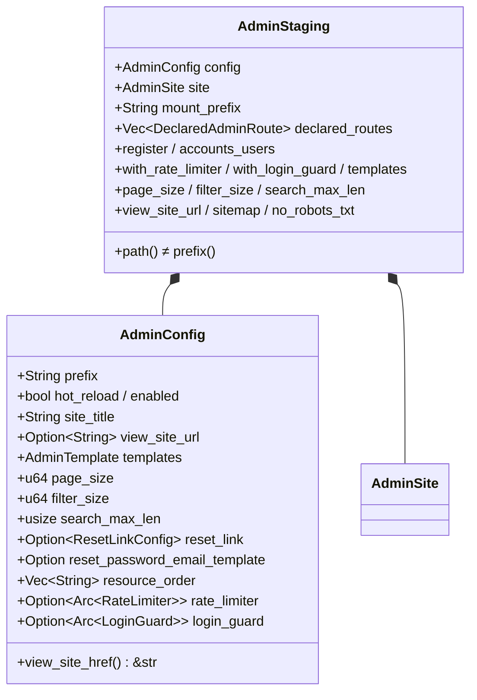
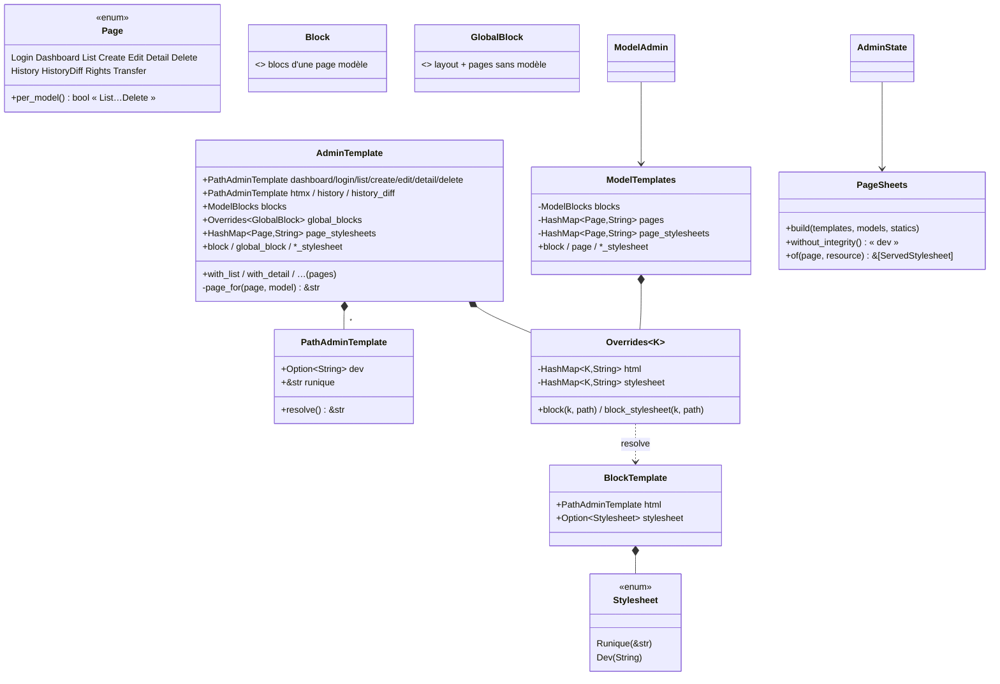
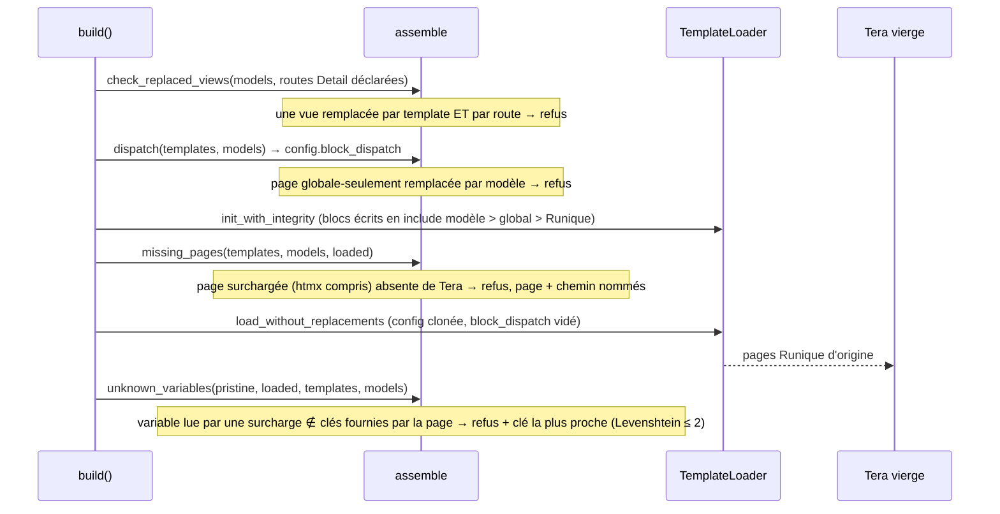
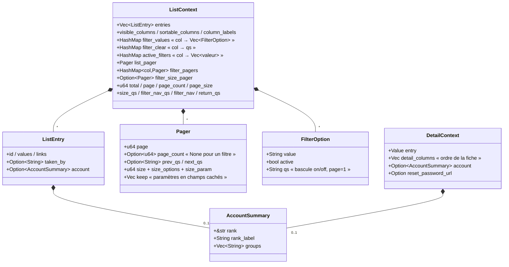
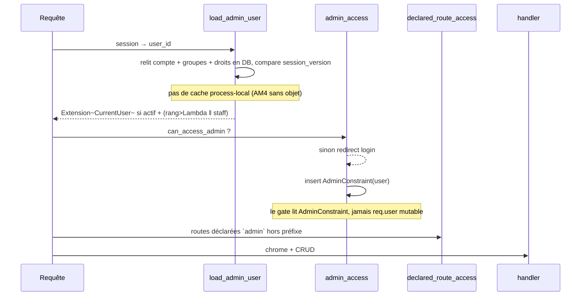
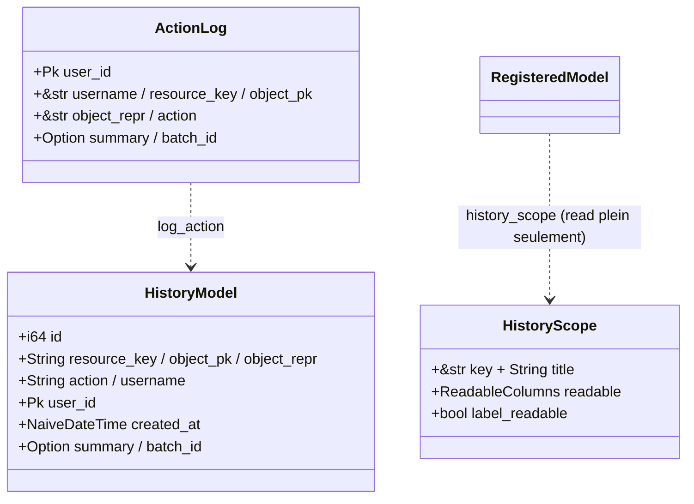
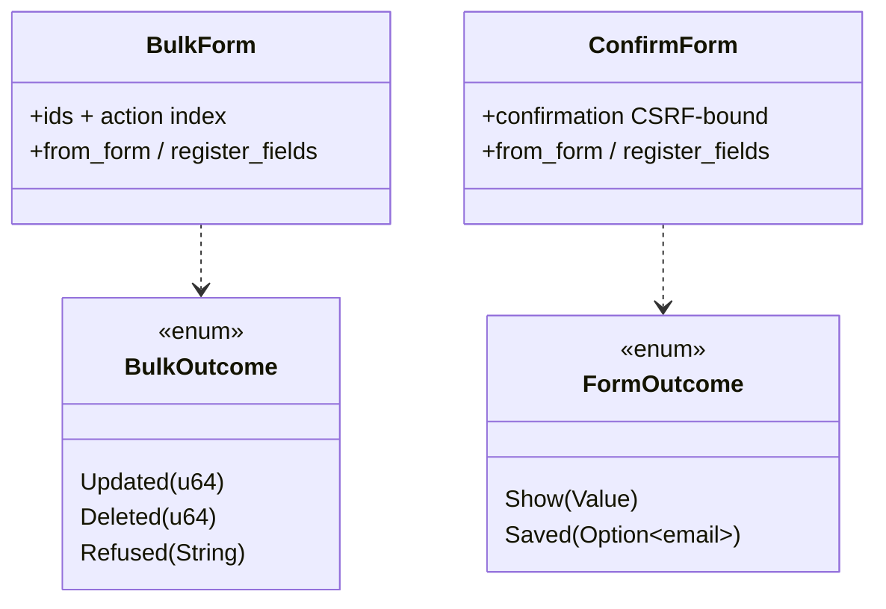

# UML — Admin 4.0 : config, templates, middleware, history, forms internes

Complément de [admin-resource-permissions.md](admin-resource-permissions.md).

## AdminConfig

[`admin/config/config_admin.rs`](../../../runique/src/admin/config/config_admin.rs)

Deux segments indépendants : `path()` = où vit l'admin (`/admin`) ;
`prefix()` = ce qu'on met devant (`/secret` → `/secret/admin`). Ils ne
s'écrasent jamais, quel que soit l'ordre d'appel.

## Templates & stylesheets

[`admin/template/`](../../../runique/src/admin/template/)

Priorité, pour une page comme pour un bloc : **modèle > global > Runique**
(`page_for`, `Block::resolve`). Une page ne se remplace par modèle que si
`Page::per_model()` (List, Create, Edit, Detail, Delete) ; sinon refus au boot.
Les feuilles de style sont résolues et hashées **au boot** (`PageSheets`), sans
`integrity` en développement (`without_integrity`), servies par page + ressource
courante via `chrome()`.

### Contrôles des surcharges au boot

Toujours actifs quand l'admin est activé, **quel que soit `RUNIQUE_ENV` ou `DEBUG`**
([`app/builder/build.rs`](../../../runique/src/app/builder/build.rs),
[`assemble.rs`](../../../runique/src/admin/template/assemble.rs)) :

Clés permises pour une page : celles que lit la page Runique d'origine
(`get_template_variables` sur le Tera vierge), plus `provided_unread(page)` —
clés de requête (`REQUEST_KEYS`), sections de traduction `admin_<section>_*`,
`page` (List), `resource_key` (Create/Edit/Delete/Rights) — plus `__tera_context`.
Tera refuse déjà lui-même, au chargement, un filtre / test / fonction / composant
inconnu ou un `include` absent ; une variable, il ne la refuse qu'au rendu : d'où ce contrôle.

### Contexte des pages (contrat des templates)

[`admin/router/context.rs`](../../../runique/src/admin/router/context.rs)

- Tailles : liste (`per_page`) et filtres (`fsize`) bornées à `PER_PAGE_OPTIONS`
  (10/25/50/100) ; une taille libre de l'URL est ignorée.
- `AccountSummary` (rang + groupes, lecture seule) : chargé par `account_summaries`
  pour la liste et la fiche des comptes, en deux requêtes par page.
- `detail_columns` : colonnes de la liste dans leur ordre, puis celles du formulaire,
  dates et heures en dernier (`ModelAdmin::detail_columns`).
- `admin_page_context(req, admin, site, page, resource)` : une route déclarée `admin`
  reçoit le chrome (feuilles, menu avec droits, barre du haut) sans aucun droit en plus.
- La page de connexion porte un lien « ← Retour au site » (`site_url`, soit `.view_site_url(…)`, défaut `/`).

## Middleware admin

[`admin/middleware/admin_middleware.rs`](../../../runique/src/admin/middleware/admin_middleware.rs)

`AdminConstraint` est `pub(crate)` : seul le middleware le pose. Le handler peut
muter `req.user` sans influencer le gate.

## History (audit)

[`auth/history.rs`](../../../runique/src/auth/history.rs) — écrit par `save_as`
**dans la même transaction** que l'écriture (admin et `save_as` projet).

- `object_repr` : libellé figé au moment de l'action (lisible après rename/delete), max 255.
- Pas de FK sur `user_id` (audit survit à la suppression du compte) — **D2** à documenter.
- `read_own` seul n'ouvre **pas** l'historique d'une ressource (impossible de savoir
  à qui appartenait une ligne passée).

## Forms internes admin (bulk / confirm)

[`admin/builder/bulk_form.rs`](../../../runique/src/admin/builder/bulk_form.rs),
[`confirm_form.rs`](../../../runique/src/admin/builder/confirm_form.rs)

Les actions groupées ne portent **jamais** la valeur à écrire : l'URL/form ne
nomme que l'index d'une `Action` déclarée (colonne + valeur fixées dans le builder).
Sur la table comptes, rangs et `is_active` sont interdits en action groupée.

## Router — pages spéciales

| Route | Rôle |
|-------|------|
| `…/rank` | POST changement de rang (gate + `Rang::cibles_gerables`) |
| `…/{id}/rights` | grille de droits d'un admin ou d'un groupe |
| `…/{id}/groups` | memberships compte ↔ groupes |
| `…/{id}/transfer` | transfert de responsabilité de groupe |
| `…/{id}/reset-password` | lien reset (gate `ResetPassword`, rang protégé) |
| `…/history` | journal filtré par `history_scopes` |

## Anomalies / notes

| ID | Note |
|----|------|
| **D2** | `user_id` history sans FK — voulu (survie audit) ; documenter |
| **D3** | Index manquants possibles (`history` composite, `sessions.user_id`, `reset_tokens.expires_at`) — valider sous DB réelle |
| **AM4** | Cache permissions process-local **supprimé** : droits relus à chaque requête admin |
| Templates | Contrat de contexte : `chrome()` injecte `resources`, `nav`, `current_user`, `stylesheets`, messages i18n ; toute variable lue par une surcharge est vérifiée au boot |
