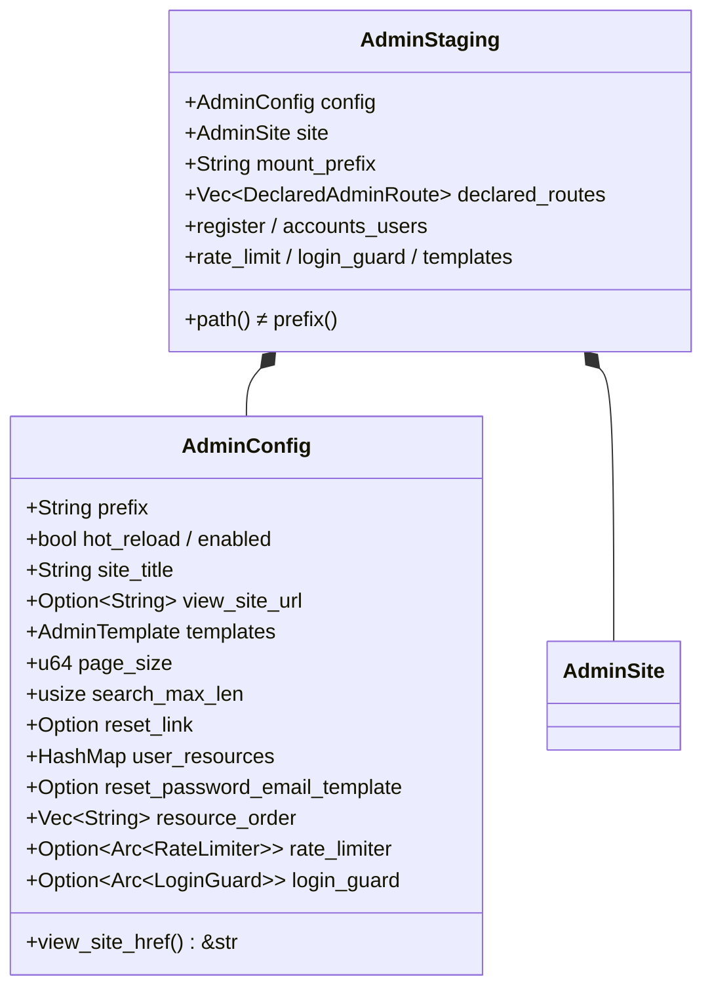
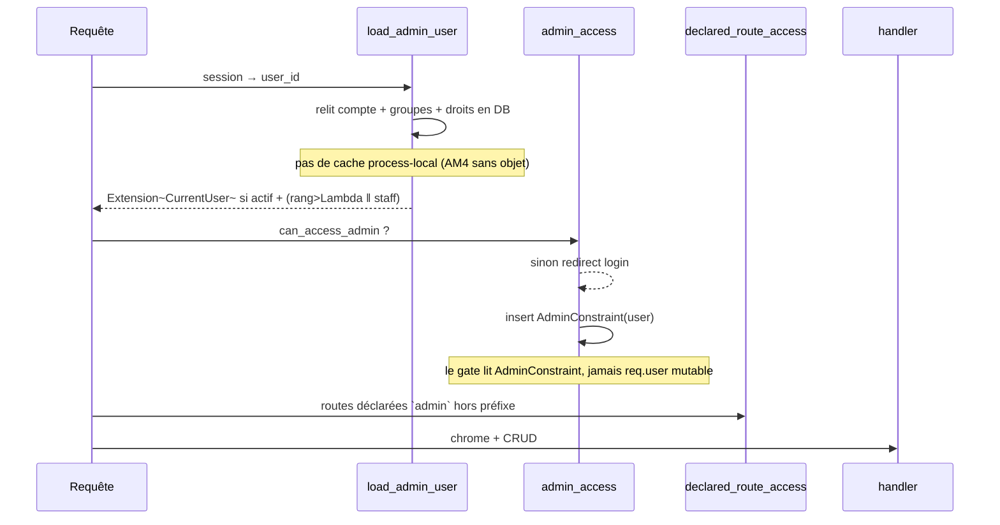
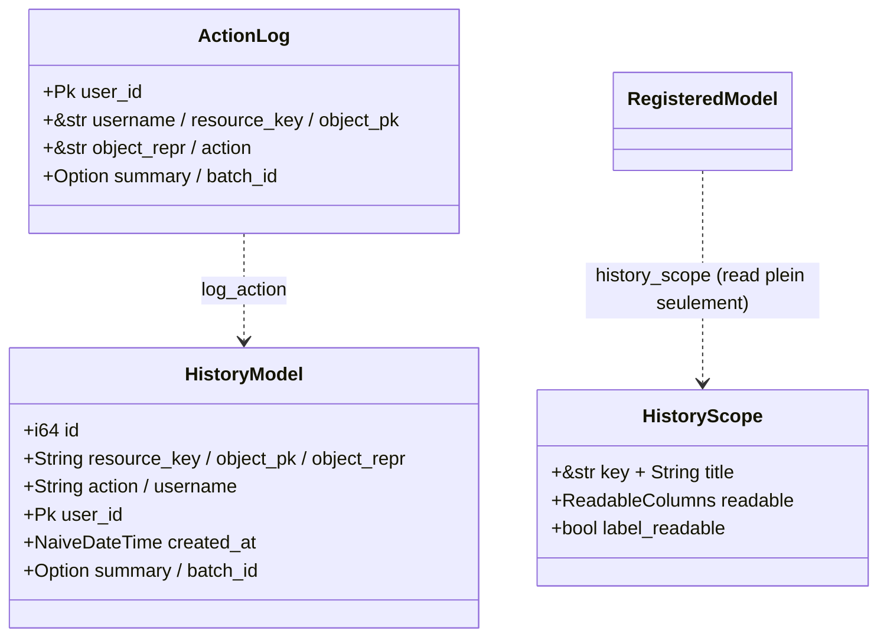
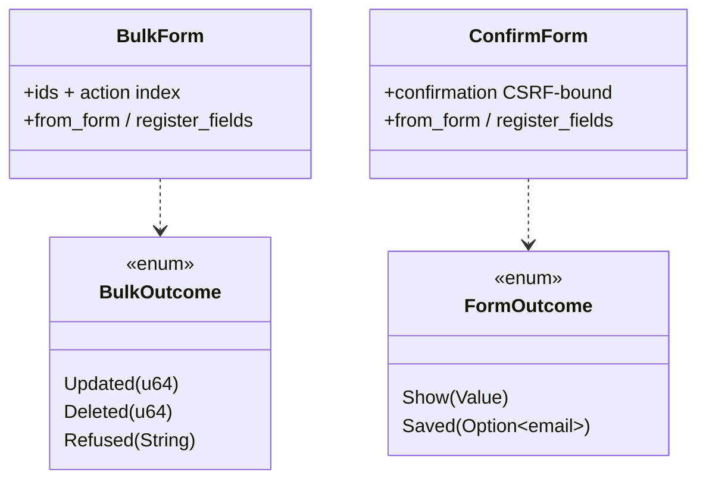

# UML — Admin 4.0 : config, templates, middleware, history, forms internes

Complément de [admin-resource-permissions.md](admin-resource-permissions.md).

## AdminConfig

[`admin/config/config_admin.rs`](../../../runique/src/admin/config/config_admin.rs)



Deux segments indépendants : `path()` = où vit l'admin (`/admin`) ;
`prefix()` = ce qu'on met devant (`/secret` → `/secret/admin`). Ils ne
s'écrasent jamais, quel que soit l'ordre d'appel.

## Templates & stylesheets

[`admin/template/`](../../../runique/src/admin/template/)

```mermaid
classDiagram
    class PathAdminTemplate {
        +Option~String~ dev
        +&str runique
        +resolve() &str
    }
    class AdminTemplate {
        +PathAdminTemplate dashboard/login/list/create/edit/detail/delete
        +PathAdminTemplate htmx / history / history_diff
    }
    class ModelTemplates {
        +pages + blocks par modèle
    }
    class Page {
        <<enum>>
        Dashboard Login List Create Edit Detail Delete History …
    }
    class PageSheets {
        +of(page, resource) stylesheets résolus + hashés au boot
    }
    class Block / GlobalBlock / ModelBlocks
    AdminTemplate *-- "*" PathAdminTemplate
    ModelAdmin --> ModelTemplates
    AdminState --> PageSheets
```

Priorité : override dev (`PathAdminTemplate.dev`) > défaut Runique. Les
feuilles de style sont résolues et hashées **au boot** (`PageSheets`), servies
par page + ressource courante via `chrome()`.

## Middleware admin

[`admin/middleware/admin_middleware.rs`](../../../runique/src/admin/middleware/admin_middleware.rs)



`AdminConstraint` est `pub(crate)` : seul le middleware le pose. Le handler peut
muter `req.user` sans influencer le gate.

## History (audit)

[`auth/history.rs`](../../../runique/src/auth/history.rs) — écrit par `save_as`
**dans la même transaction** que l'écriture (admin et `save_as` projet).



- `object_repr` : libellé figé au moment de l'action (lisible après rename/delete), max 255.
- Pas de FK sur `user_id` (audit survit à la suppression du compte) — **D2** à documenter.
- `read_own` seul n'ouvre **pas** l'historique d'une ressource (impossible de savoir
  à qui appartenait une ligne passée).

## Forms internes admin (bulk / confirm)

[`admin/builder/bulk_form.rs`](../../../runique/src/admin/builder/bulk_form.rs),
[`confirm_form.rs`](../../../runique/src/admin/builder/confirm_form.rs)



Les actions groupées ne portent **jamais** la valeur à écrire : l'URL/form ne
nomme que l'index d'une `Action` déclarée (colonne + valeur fixées dans le builder).
Sur la table comptes, rangs et `is_active` sont interdits en action groupée.

## Router — pages spéciales

| Route | Rôle |
|-------|------|
| `…/rank` | POST changement de rang (gate + `Rang::cibles_gerables`) |
| `…/{id}/rights` | grille de droits d'un admin ou d'un groupe |
| `…/{id}/groups` | memberships compte ↔ groupes |
| `…/{id}/transfer` | transfert de responsabilité de groupe |
| `…/{id}/reset-password` | lien reset (gate `ResetPassword`, rang protégé) |
| `…/history` | journal filtré par `history_scopes` |

## Anomalies / notes

| ID | Note |
|----|------|
| **D2** | `user_id` history sans FK — voulu (survie audit) ; documenter |
| **D3** | Index manquants possibles (`history` composite, `sessions.user_id`, `reset_tokens.expires_at`) — valider sous DB réelle |
| **AM4** | Cache permissions process-local **supprimé** : droits relus à chaque requête admin |
| Templates | Contrat de contexte : `chrome()` injecte `resources`, `nav`, `current_user`, `stylesheets`, messages i18n |
