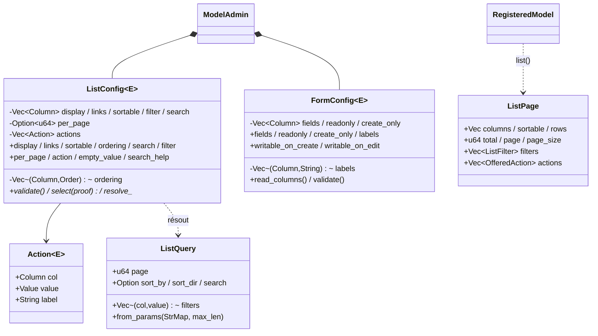
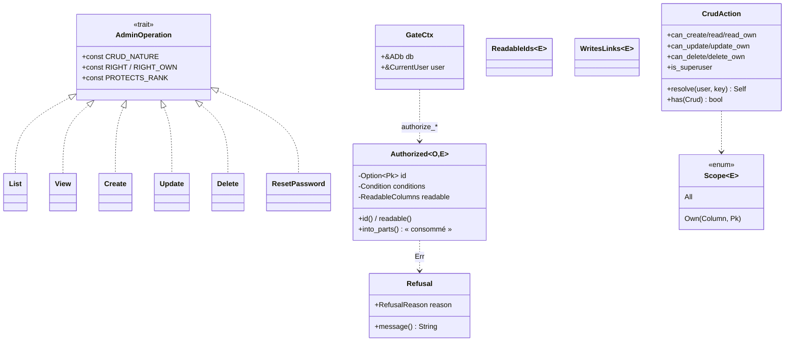
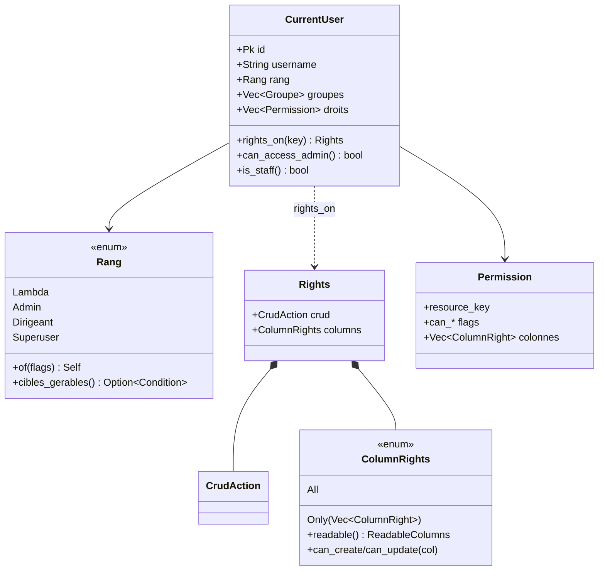
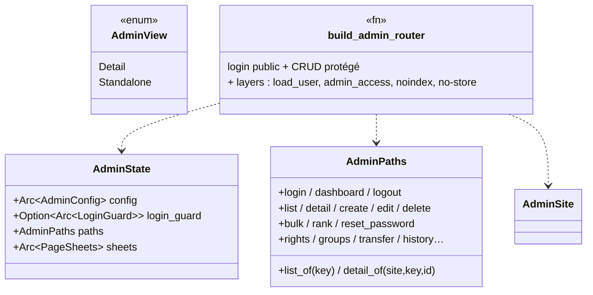
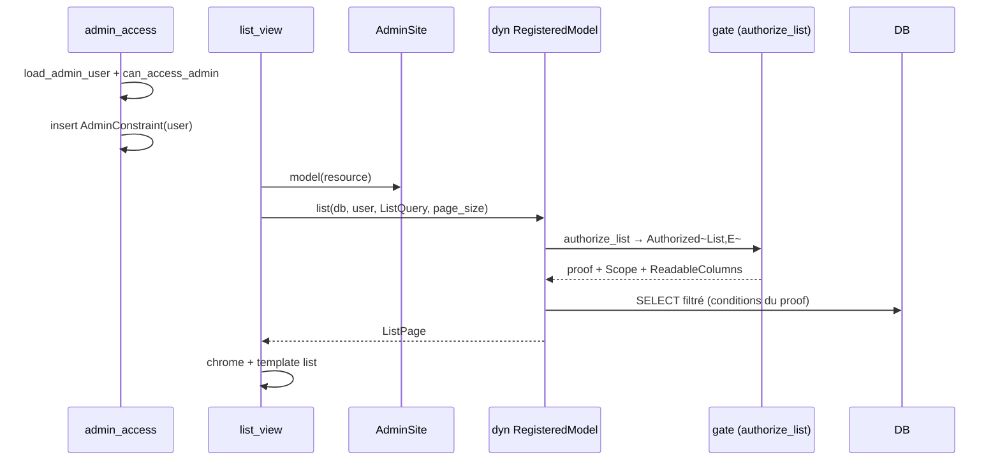

# UML — Admin 4.0 : ModelAdmin, AdminSite, gate, droits

Refonte 4.0 : plus de `AdminRegistry` / `ResourceEntry` / closures CRUD optionnelles.
Un modèle s'enregistre via un builder typé `ModelAdmin<E: ModelMeta>` ; le site
efface le type derrière `dyn RegisteredModel` ; **chaque écriture passe par le gate**
(`auth::gate`) qui délivre une preuve `Authorized<O, E>` consommée une seule fois.

Sources :
[`admin/builder/`](../../../runique/src/admin/builder/),
[`admin/router/`](../../../runique/src/admin/router/),
[`auth/gate/`](../../../runique/src/auth/gate/),
[`auth/meta.rs`](../../../runique/src/auth/meta.rs),
[`auth/permissions/`](../../../runique/src/auth/permissions/)

## Vue d'ensemble

```mermaid
classDiagram
    class AdminStaging {
        +AdminConfig config
        +bool enabled
        +AdminSite site
        +register(ModelAdmin) Self
        +accounts_users(ModelAdmin) Self
        +path / prefix / resource_order / templates…
        +validate() CheckReport
    }
    class AdminSite {
        -Vec~Box~RegisteredModel~~ models
        -Box~RegisteredModel~ accounts
        -Box~RegisteredModel~ groups
        -HashMap overrides
        +register(ModelAdmin) Self
        +accounts_users(ModelAdmin) Self
        +model(key) Option~&dyn RegisteredModel~
        +navigation(user, order) Vec~NavEntry~
        +history_scopes(db, user) Vec~HistoryScope~
        +check() Vec~String~
    }
    class ModelAdmin~E: ModelMeta~ {
        +ListConfig~E~ list
        +FormConfig~E~ form
        +Option~String~ title
        +ModelTemplates templates
        +new() / title() / list() / form() / templates()
        +validate() Result
    }
    class RegisteredModel {
        <<trait async>>
        +key() / pk_column() / title() / check()
        +visible_to(user) bool
        +rights(user) CrudAction
        +list / detail / create / edit / delete / bulk
        +reset_password / history_scope / count_query
        +keeps_account_rules() bool
    }
    class ModelMeta {
        <<trait>>
        +const KEY
        +const OWNER / SECRET / LABEL
        +const IS_ACCOUNT_TABLE / IS_FRAMEWORK_TABLE
        +type Form
        +schema() ModelSchema
    }
    AdminStaging *-- AdminSite
    AdminStaging *-- AdminConfig
    AdminSite o-- "*" RegisteredModel
    ModelAdmin ..|> RegisteredModel : impl for E
    ModelAdmin ..> ModelMeta : E:
```

`AdminSite::default()` pose déjà l'admin des comptes (`eihwaz_users`) et des groupes
(`eihwaz_groupes`). Un projet ne peut remplacer les comptes que via
`accounts_users()` (un `register` sous la même clé est refusé au boot).

## ListConfig & FormConfig (déclaratif, typé colonnes)



Rien de l'URL n'est crédible : `ListQuery` ne fait que parser ; `ListConfig` décide
quelles colonnes un nom peut atteindre (tri, filtre, recherche). Les secrets
(`ModelMeta::SECRET`) et les flags de rang (`is_superuser` / `is_dirigeant` /
`is_admin`) sont refusés dès `ModelAdmin::validate()`.

## Gate — preuves typées (source unique d'autorisation)



Trois niveaux, dans l'ordre (tout « non » → même `Refusal`) :

1. **Plancher Runique** — tables framework, secrets, comptes superuser, rangs ;
2. **Droits du compte** — rang ou groupes (`CrudAction` / `ColumnRights`) ;
3. **Règles métier du projet** — ne peuvent que restreindre.

`Authorized` n'est ni `Clone` ni `Copy` : une écriture le consomme. Son
constructeur est `pub(in crate::auth::gate)` — un court-circuit hors du module
apparaît comme un changement de visibilité en revue.

## Rang & résolution des droits



| Rang | Source des droits |
|------|-------------------|
| Superuser | tout (`is_superuser` bypass) |
| Dirigeant | tout sauf bypass superuser |
| Admin | grille posée sur **son compte** (`droits`, `user_id` dans `eihwaz_groupes_droits`) |
| Lambda | union des **groupes** ; **jamais** sur une table framework |

`is_staff` n'est plus un flag user : c'est un flag **groupe**. Un lambda entre
dans l'admin s'il appartient à au moins un groupe `is_staff`.

## Router admin (routes générées + couches)



Routes modèle (extrait) : `{prefix}/{resource}/list|create|bulk`,
`{prefix}/{resource}/{id}/detail|edit|delete|reset-password|rights|groups|transfer`,
plus history, rank, group_select. Les handlers ne font que router : auth,
`CurrentUser`, `AdminConstraint` et chrome viennent des layers.

## Flux d'une page liste (résumé)



## Anomalies / flux suspects

| ID | Observation | Statut |
|----|-------------|--------|
| **A1/A2** (closures Option no-op / own_field) | Architecture 3.x — **disparue**. Plus de closures CRUD ; ownership = `ModelMeta::OWNER` + preuves gate | ✅ sans objet en 4.0 |
| **A3** (`list_filter` builtins sans `filter_fn`) | Plus de builtins manuels ni `filter_fn` : filtres = `ListConfig::filter` + valeurs lues en base sous le scope du proof | ✅ sans objet |
| **A7** (pas de `get_queryset`) | Toujours ouvert côté design : le gate accepte des règles métier restrictives, pas encore d'API publique « queryset » arbitraire type Django | 🟡 backlog |
| **Gate** | Preuve non clonable + `WHERE` rejoué à l'écriture → TOCTOU d'une ligne concurrente = refus (0 row), pas d'écriture fantôme | design voulu |
| **can_read_own** | Colonne présente en base ; résolution rang/grille opérationnelle. Vérifier la couverture UI grille si un admin doit la cocher | à surveiller |

Voir aussi [admin-complements.md](admin-complements.md) (templates, history, middleware)
et [../auth/authentification.md](../auth/authentification.md).
