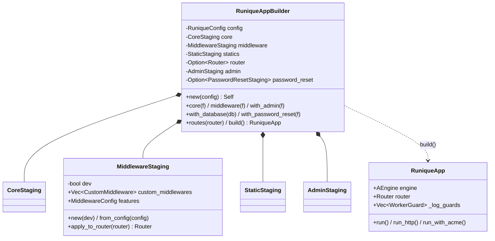
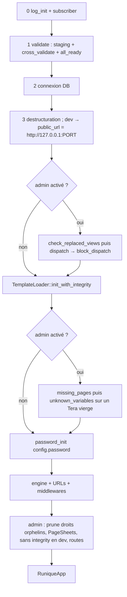
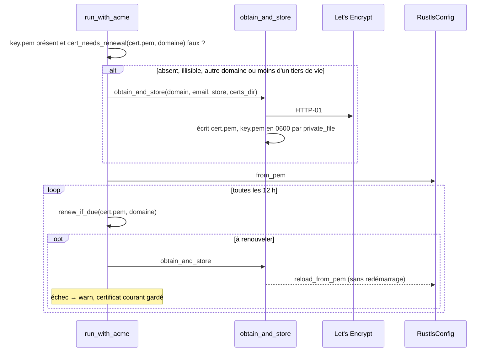
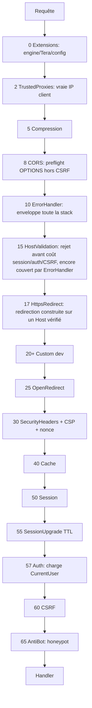

# UML — App : builder, staging, pipeline middleware

[`app/builder/mod.rs`](../../../runique/src/app/builder/mod.rs),
[`app/runique_app.rs`](../../../runique/src/app/runique_app.rs),
[`app/staging/middleware_staging/applicator.rs`](../../../runique/src/app/staging/middleware_staging/applicator.rs)

## Builder & staging (pattern Builder)

Collecte différée : chaque `.core()/.middleware()/.with_admin()` **stocke** sans exécuter ;
`build()` assemble (ordre indépendant de l'ordre d'appel du dev).

Mode : `RUNIQUE_ENV` (`dev` ou `prod`, `prod` si absente ou inconnue) donne `config.dev`,
qui choisit le profil (`MiddlewareConfig::development()` / `production()`), la validation
des hôtes par défaut, l'URL publique, le SRI. `DEBUG` ne règle plus que les pages d'erreur
détaillées.

## `build()` — étapes

[`app/builder/build.rs`](../../../runique/src/app/builder/build.rs)

Les deux contrôles de l'admin (page absente, variable inconnue) refusent le démarrage
**dans tous les environnements** : aucune variable d'env ne les désactive. Détail :
[../admin/admin-complements.md](../admin/admin-complements.md#contrôles-des-surcharges-au-boot).

## ACME — renouvellement à chaud

[`app/runique_app.rs`](../../../runique/src/app/runique_app.rs)

## Pipeline middleware par slots (ordre réel exécuté)

`apply_to_router` trie par slot. Ordre **extérieur → intérieur** (un slot bas = plus externe) :

## Anomalies / flux suspects

### ✅ AP1 — `RuniqueEngine::attach_middlewares` était du code mort (confirmait E2) — SUPPRIMÉ (2026-09-21)
Le pipeline réel est `MiddlewareStaging::apply_to_router` (slots ci-dessus). Trouvé en creusant
un bug réel du chemin vivant : slot 30 (`security_headers_middleware`, toujours actif) écrasé
par slot 31 (`csp_middleware`, ajouté dès `.with_csp()`) — le nonce CSP disparaît du header final.
Voir E3 dans `anomalies.md` pour ce bug encore ouvert.

### 🟡 AP2 — ErrorHandler (slot 10) gaté par `enable_debug_errors` (confirme E1, rétrogradé)
[`applicator.rs:348`](../../../runique/src/app/staging/middleware_staging/applicator.rs#L348)
Monté car le flag vaut `true` par défaut partout. Risque uniquement si désactivé
explicitement (nom trompeur). Pas un bug par défaut.

### 🟢 AP3 — Ordre des slots : cohérent et justifié (pas d'anomalie)
CORS (8) **hors** ErrorHandler (10) pour que le preflight OPTIONS n'atteigne jamais CSRF ;
Session (50) avant CSRF (60) car CSRF en dépend ; Auth (57) après Session. Ordre sain,
documenté slot par slot. À conserver tel quel.

**HostValidation déplacé du slot 70 au slot 15** : auparavant dernier middleware avant le
handler, il payait le coût Session/SessionUpgrade/Auth/CSRF/AntiBot sur une requête au Host
invalide. Repositionné juste après ErrorHandler (10) — toujours couvert par son filet
anti-panic, mais rejette désormais un Host invalide avant ce coût.
