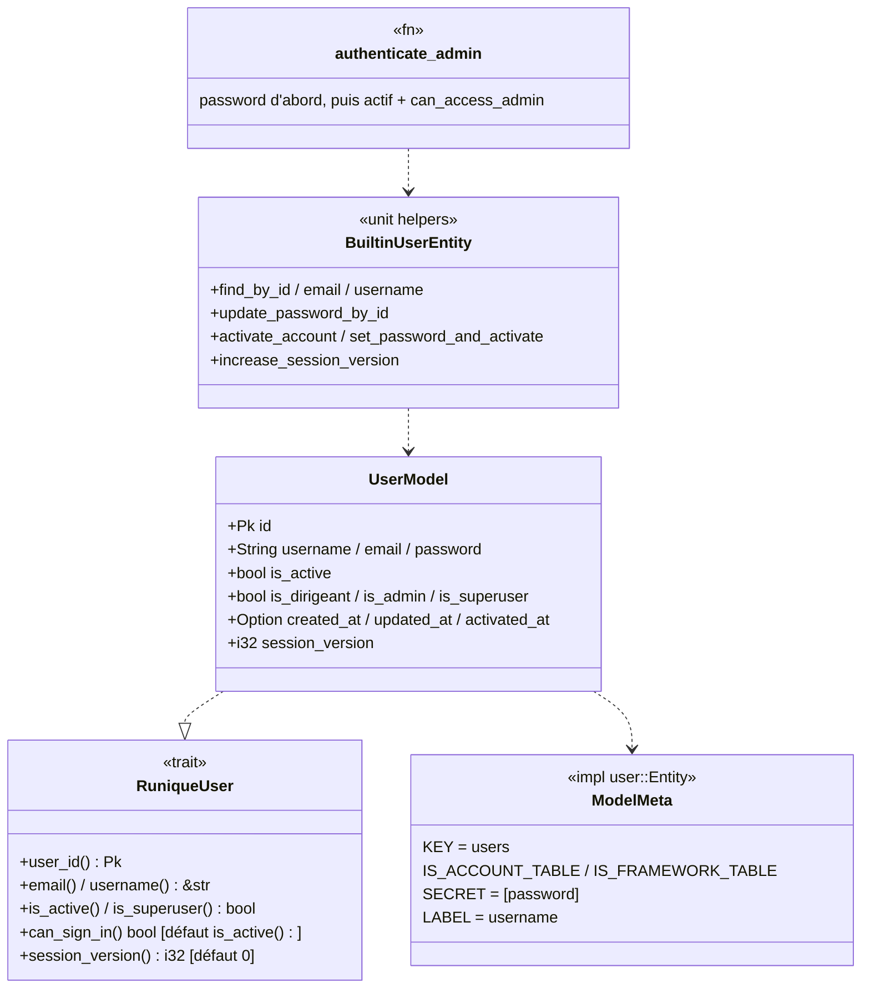
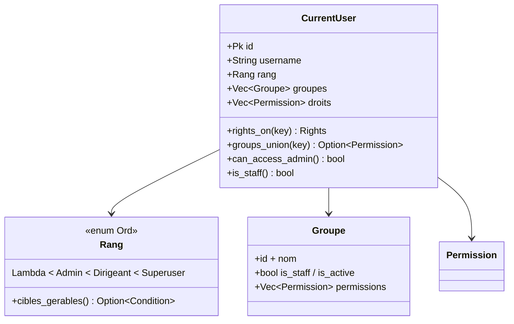
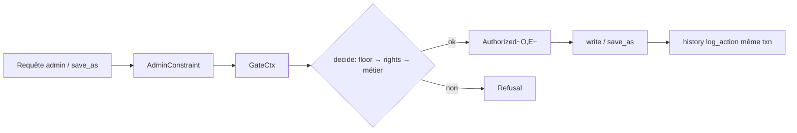
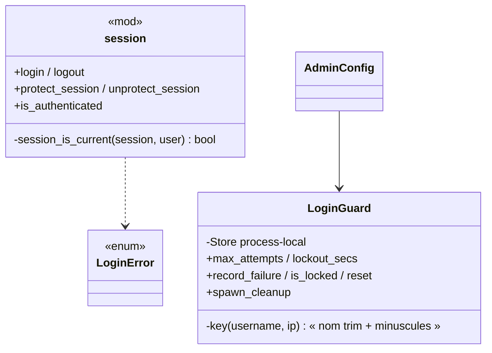
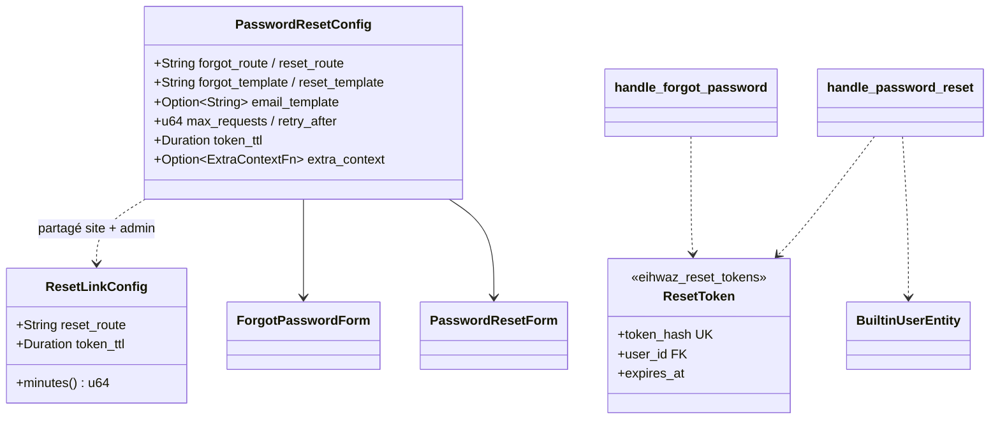
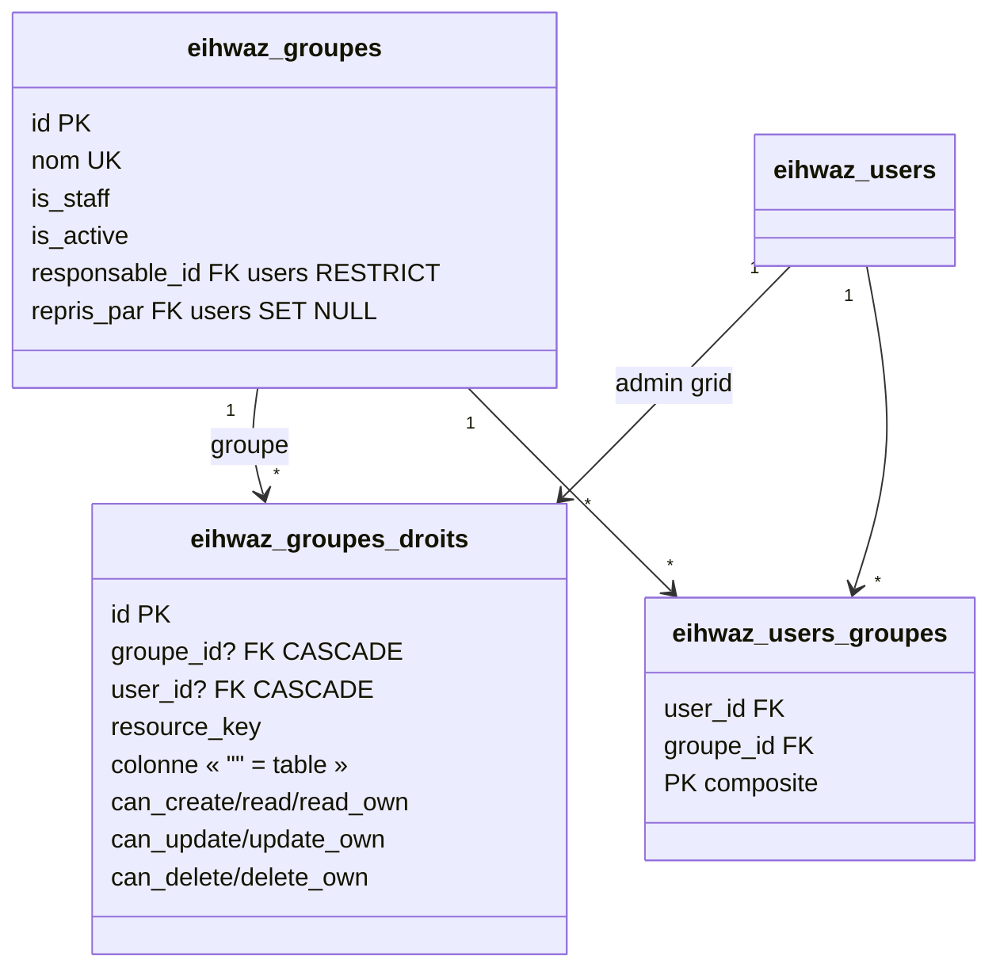

# UML — Authentification 4.0 (session, gate, rang, reset)

Sources :
[`auth/`](../../../runique/src/auth/),
[`auth/gate/`](../../../runique/src/auth/gate/),
[`auth/permissions/`](../../../runique/src/auth/permissions/),
[`auth/migrations_table.rs`](../../../runique/src/auth/migrations_table.rs)

## Comptes (`eihwaz_users`)

Changements 4.0 vs diagrammes 3.x :

- **`is_staff` retiré du user** — le staff est un flag de **groupe**.
- **`is_dirigeant` + `is_admin`** ajoutés ; CHECK DB `ONE_RANK_AT_MOST` (au plus un rang).
- CHECK `ACTIVE_NEEDS_ACTIVATION` : `is_active` ⇒ `activated_at` non NULL.
- **`session_version`** : jamais dans un formulaire ; sa hausse ferme les sessions du compte, dans tous les stores.
- Migrations framework déplacées : `auth/migrations_table.rs` (plus `admin/table_admin/`).

## CurrentUser & Rang

`can_access_admin` = `rang > Lambda` **ou** membre d'un groupe `is_staff`.
Les droits d'un Admin sont sur **son compte** (`droits`) ; ceux d'un Lambda
viennent de l'union de ses groupes ; Superuser/Dirigeant = tout (sans grille).

## Gate (preuves) — cœur sécurité écritures

Voir le détail classes dans [../admin/admin-resource-permissions.md](../admin/admin-resource-permissions.md).

Opérations : `List`, `View`, `Create`, `Update`, `Delete`, `ResetPassword`.
Sur la table comptes, `Update`/`Delete`/`ResetPassword` appliquent
`Rang::cibles_gerables` (strictement inférieur, jamais soi-même).

## Session & lockout

TTL session : source unique builder (`OnceLock`, défaut 24h) — **AM3** corrigé.
Lockout / rate-limit restent process-local → limite multi-instance (roadmap).
La clé du `LoginGuard` est le nom sans espaces autour et en minuscules : une base qui
compare sans casse (MySQL/MariaDB) ouvre le même compte pour `admin`, `Admin`, `admin `,
qui partagent donc un seul compteur. La déconnexion de l'admin exige un jeton CSRF valide.

## Reset password

Token brut uniquement dans le mail ; DB = hash. `consume` single-use
(`rows_affected == 1`). `user_id` vient du token, jamais de l'URL → IDOR-safe.
Réponse forgot identique si email inconnu (anti-énumération). Route reset :
`{reset_route}/{token}` (jeton dans le chemin), servie en `no-store`. Le nouveau mot de
passe est haché par `PasswordService::new(password_get())` : la stratégie déclarée par
`password_init` (les champs du formulaire sont `.no_hash()` pour comparer les deux saisies).
E-mails intégrés (`builtin_reset_body`, `builtin_blocked_body`) : nom et lien échappés,
`{` compris (`tf` remplirait sinon un `{}` injecté). `success_redirect` n'existe plus :
la page se réaffiche avec `reset_done = true`.

Un reset réussi écrit dans **une seule transaction** : mot de passe, activation éventuelle,
`session_version + 1`, suppression des sessions du compte. Détail :
[../../flux/auth-session-et-makemigrations.md](../../flux/auth-session-et-makemigrations.md).

## Permissions en base

CHECK : exactement un holder (`groupe_id` XOR `user_id`) ; un groupe ne cible
jamais une table framework ; une ligne colonne n'a que read/create/update.

## Anomalies / notes

| ID | Note | Statut |
|----|------|--------|
| **AM3** | TTL session unique | ✅ |
| **AM4** | cache permissions | ✅ supprimé (relecture DB) |
| **S1/S2** | sessions anonymes / lock avant write | ouverts (DB) |
| **AU1** | lockout process-local | multi-instance roadmap |
| **SU1** | create-superuser pk-uuid | ✅ |
| **S6** | reset sous store personnalisé | ✅ `session_version` |
| Rank rule | codée en WHERE, pas en pre-read cible | design voulu |
