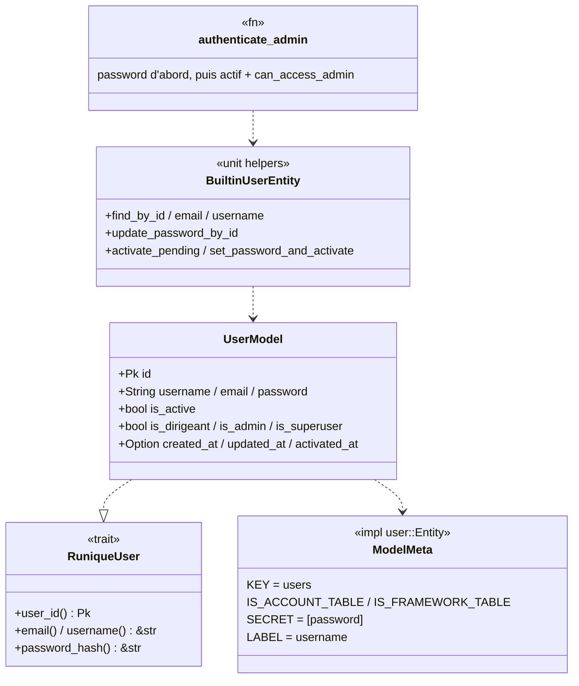
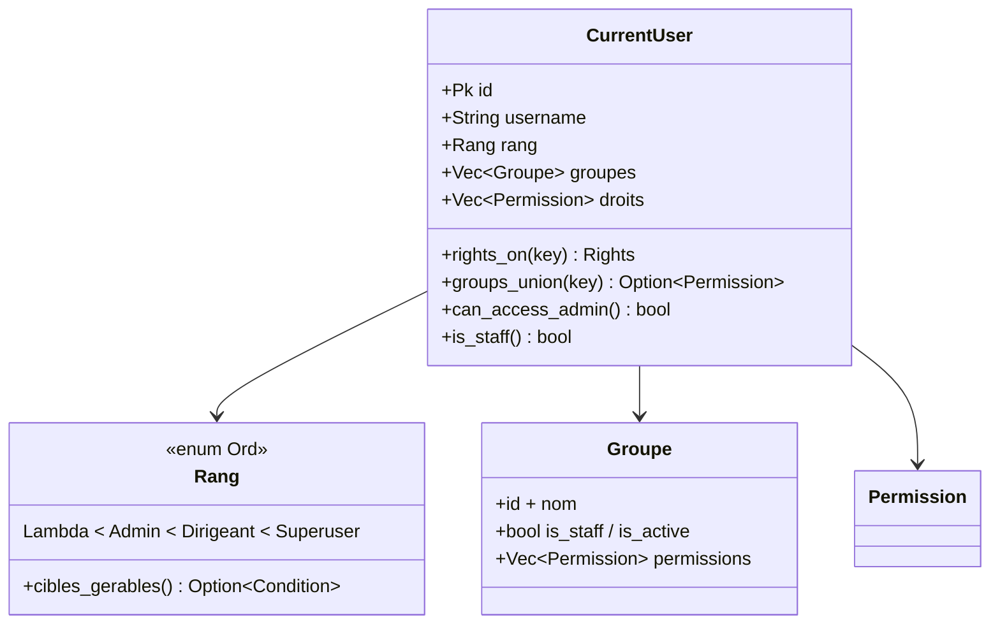
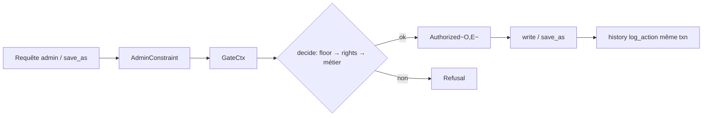
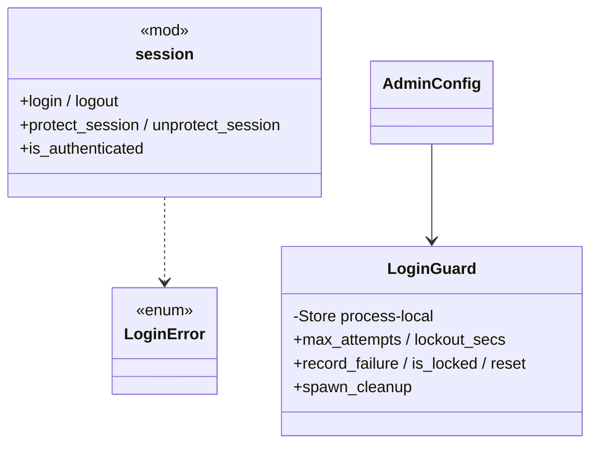
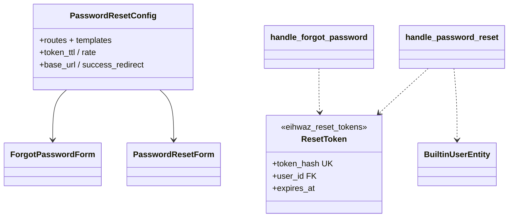

# UML — Authentification 4.0 (session, gate, rang, reset)

Sources :
[`auth/`](../../../runique/src/auth/),
[`auth/gate/`](../../../runique/src/auth/gate/),
[`auth/permissions/`](../../../runique/src/auth/permissions/),
[`auth/migrations_table.rs`](../../../runique/src/auth/migrations_table.rs)

## Comptes (`eihwaz_users`)



Changements 4.0 vs diagrammes 3.x :

- **`is_staff` retiré du user** — le staff est un flag de **groupe**.
- **`is_dirigeant` + `is_admin`** ajoutés ; CHECK DB `ONE_RANK_AT_MOST` (au plus un rang).
- CHECK `ACTIVE_NEEDS_ACTIVATION` : `is_active` ⇒ `activated_at` non NULL.
- Migrations framework déplacées : `auth/migrations_table.rs` (plus `admin/table_admin/`).

## CurrentUser & Rang



`can_access_admin` = `rang > Lambda` **ou** membre d'un groupe `is_staff`.
Les droits d'un Admin sont sur **son compte** (`droits`) ; ceux d'un Lambda
viennent de l'union de ses groupes ; Superuser/Dirigeant = tout (sans grille).

## Gate (preuves) — cœur sécurité écritures

Voir le détail classes dans [../admin/admin-resource-permissions.md](../admin/admin-resource-permissions.md).



Opérations : `List`, `View`, `Create`, `Update`, `Delete`, `ResetPassword`.
Sur la table comptes, `Update`/`Delete`/`ResetPassword` appliquent
`Rang::cibles_gerables` (strictement inférieur, jamais soi-même).

## Session & lockout



TTL session : source unique builder (`OnceLock`, défaut 24h) — **AM3** corrigé.
Lockout / rate-limit restent process-local → limite multi-instance (roadmap).

## Reset password



Token brut uniquement dans le mail ; DB = hash. `consume` single-use
(`rows_affected == 1`). `user_id` vient du token, jamais de l'URL → IDOR-safe.
Réponse forgot identique si email inconnu (anti-énumération).

## Permissions en base

```mermaid
classDiagram
    class eihwaz_groupes {
        id PK
        nom UK
        is_staff
        is_active
        responsable_id FK users RESTRICT
        repris_par FK users SET NULL
    }
    class eihwaz_groupes_droits {
        id PK
        groupe_id? FK CASCADE
        user_id? FK CASCADE
        resource_key
        colonne  « "" = table »
        can_create/read/read_own
        can_update/update_own
        can_delete/delete_own
    }
    class eihwaz_users_groupes {
        user_id FK
        groupe_id FK
        PK composite
    }
    eihwaz_groupes ||--o{ eihwaz_groupes_droits : groupe
    eihwaz_users ||--o{ eihwaz_groupes_droits : admin grid
    eihwaz_users ||--o{ eihwaz_users_groupes
    eihwaz_groupes ||--o{ eihwaz_users_groupes
```

CHECK : exactement un holder (`groupe_id` XOR `user_id`) ; un groupe ne cible
jamais une table framework ; une ligne colonne n'a que read/create/update.

## Anomalies / notes

| ID | Note | Statut |
|----|------|--------|
| **AM3** | TTL session unique | ✅ |
| **AM4** | cache permissions | ✅ supprimé (relecture DB) |
| **S1/S2** | sessions anonymes / lock avant write | ouverts (DB) |
| **AU1** | lockout process-local | multi-instance roadmap |
| **SU1** | create-superuser pk-uuid | ✅ |
| Rank rule | codée en WHERE, pas en pre-read cible | design voulu |
