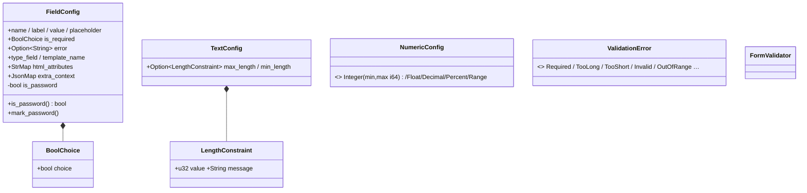

# UML — Forms : tous les types de champs, options, validator

Complément de [formulaires.md](formulaires.md) (Forms, GenericField, traits). Tous les champs
implémentent `FormField` et portent un `FieldConfig` de base (`base`).

## Champs concrets (un par fichier de `forms/fields/`)

```mermaid
classDiagram
    class FormField { <<trait>> }
    class TextField {
        +SpecialFormat? format
        +TextConfig config
        text/email/password/url/textarea/richtext/slug…
    }
    class SpecialFormat { <<enum>> Email/Password/Url/… }
    class NumericField {
        +NumericConfig (Integer/Float/Decimal/Percent/Range)
        +min / max (f64) · min_i64 / max_i64 (entiers exacts)
    }
    class BooleanField
    class ChoiceField { +Vec~ChoiceOption~ }
    class RadioField { +Vec~ChoiceOption~ }
    class CheckboxField { +Vec~ChoiceOption~ }
    class ChoiceOption { +value +label }
    class DateField
    class TimeField
    class DateTimeField
    class DurationField
    class FileField { +FileFieldType field_type +UploadMedia upload }
    class FileFieldType { <<enum>> None/Document/Any }
    class MediaField { +MediaKind kind +UploadMedia upload +max_width +max_height }
    class MediaKind { <<enum>> Image/Audio/Video }
    class UploadMedia {
        +AllowedExtensions allowed_extensions
        +FileUploadConfig upload_config
        +model_max_size +max_files +prev_value
        -pending_uploads / published_uploads
        -check(base) UploadCheck
        -finalize / publish / rollback / complete
    }
    class AllowedExtensions { images()/audio()/video()/documents()/any() }
    class FileSize { u64 }
    class FileUploadConfig { +upload_to +max_size }
    class HiddenField
    class HoneypotField
    class ColorField
    class SlugField
    class UUIDField
    class JSONField
    class IPAddressField

    TextField ..|> FormField
    NumericField ..|> FormField
    BooleanField ..|> FormField
    ChoiceField ..|> FormField
    RadioField ..|> FormField
    CheckboxField ..|> FormField
    DateField ..|> FormField
    TimeField ..|> FormField
    DateTimeField ..|> FormField
    DurationField ..|> FormField
    FileField ..|> FormField
    MediaField ..|> FormField
    HiddenField ..|> FormField
    HoneypotField ..|> FormField
    ColorField ..|> FormField
    SlugField ..|> FormField
    UUIDField ..|> FormField
    JSONField ..|> FormField
    IPAddressField ..|> FormField
    TextField *-- SpecialFormat
    ChoiceField *-- "*" ChoiceOption
    FileField *-- FileFieldType
    FileField *-- UploadMedia
    MediaField *-- UploadMedia
    MediaField *-- MediaKind
    UploadMedia *-- FileUploadConfig
    UploadMedia *-- AllowedExtensions
```

`FileField` et `MediaField` partagent `UploadMedia` : quota, extension, taille, déplacement et
retour arrière. Quelle que soit la liste d'extensions (`any()` compris), `ACTIVE_CONTENT`
est toujours refusé : `.svg`, `.svgz`, `.html`, `.htm`, `.xhtml`, `.xht`, `.shtml`, `.xml`,
`.js`, `.mjs` — ce qu'un navigateur ouvre comme document du site une fois servi depuis
`MEDIA_ROOT` (la CSP des médias ajoute `form-action 'none'`). Un upload qui ne peut pas
s'écrire montre au visiteur `upload_failed` (phrase traduite), le chemin et l'erreur OS
restant dans le journal. Un plafond de form au-delà de celui du modèle est refusé par un
message traduit (`forms.max_size_above_model`). `MediaField` vérifie en plus le contenu : signature (`has_av_signature` pour
l'audio et la vidéo, signature et `max_dimensions` pour l'image). `FileField::image()` n'existe
plus. DSL : `image`, `audio`, `video` donnent `MediaField` ; `document`, `file` donnent `FileField`.

## Options & validation

Bornes numériques :
- `Integer` garde des bornes `i64` exactes (`min_i64` / `max_i64`, utilisées par le code
  généré d'un `bigint`) : au-delà de 2^53 un `f64` les arrondissait.
- `Decimal` : une borne non posée n'est plus comparée (`.min()` seul ou `.max()` seul).
- Colonne `float` (32 bits) : `apply_column_type` borne le champ à `±f32::MAX`, l'erreur
  tombe à la validation et non à l'écriture.
- `JSONField` : une valeur faite d'espaces est vide à la validation comme à l'écriture.
- Champ non fichier : un fichier envoyé sous son nom (valeur = chemin de staging,
  `is_staged_path`) est ignoré avec un `warn`, jamais pris pour la saisie ni réaffiché.
- `TextField` : un `password` venu de la requête est
  haché même s'il a la forme d'un hash ; le texte riche d'un `<textarea>` est échappé une
  seule fois ; le filtre de protocoles (`javascript:`, `data:`…) n'agit qu'en début de texte
  ou après un séparateur.

## Anomalies / flux suspects

### 🟢 Champs = Strategy par type (audit clean)
Chaque type implémente `FormField` (validate/render propres). Dispatch unifié via
`GenericField`/`GeneratedField`. Architecture saine — c'est le bon endroit pour la logique
spécifique par champ (cf. discussion GoF). Rien à corriger.

### 🟡 Rappel — `HoneypotField` / `force_invalid`
Le honeypot (anti-bot) pose `force_invalid` sur le `Forms` ; l'ordre vs `fill`/`is_valid`
est traité dans [../../flux/requete-csrf-upload.md](../../flux/requete-csrf-upload.md) (C-series).
