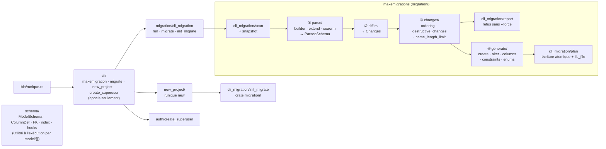

# Migration — organisation des modules (2026-11-12)

Le dossier `migration/` suit les étapes que traverse `makemigrations`. `cli/` ne contient que les
appels des commandes ; la logique vit dans son domaine.

| Dossier | Pur ? | Rôle |
|---|---|---|
| `schema/` | oui | décrire un modèle (code généré par `model!{}`, formulaires) |
| `parse/` | oui | lire le DSL, `extend!{}` et les fichiers SeaORM existants |
| `diff.rs` | oui | comparer le snapshot et le modèle |
| `changes/` | oui | trier par FK, lister les changements destructifs et les noms trop longs |
| `generate/` | oui | produire le texte des fichiers de migration |
| `cli_migration/` | non (fichiers, terminal) | scanner, lire les snapshots, refuser, écrire, `migration up/down/status`, crate `migration/` |

Règle : `cli_migration/` appelle les dossiers purs, jamais l'inverse ; `cli/` n'appelle que
`cli_migration/`, `new_project/` et `auth/`.
