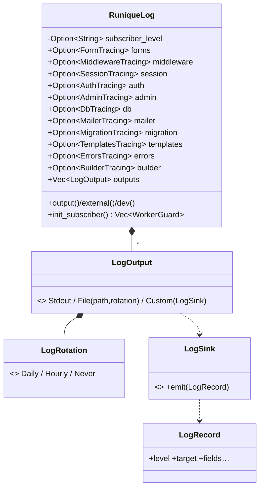
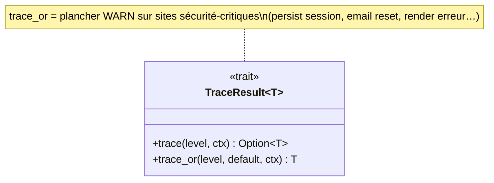
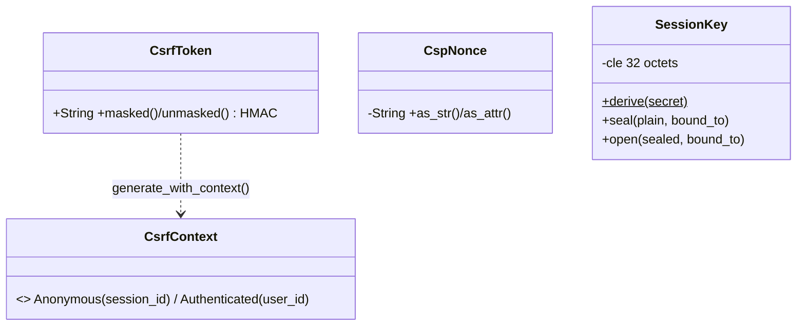

# UML — utils : tracing, TraceResult, tokens CSRF/CSP

## Tracing — `RuniqueLog` (arbre par domaine)

[`utils/config/runique_log/`](../../../runique/src/utils/config/runique_log/)

Chaque `*Tracing` (FormTracing, AuthTracing, AdminTracing…) = sous-struct avec une feuille
`Option<LogLevel>` par sous-canal (`LogLevel` = `tracing::Level` du prelude) → activation fine par domaine. `runique_log!(level, …)` émet ;
`get_log().<domaine>.<canal>` lit le niveau gaté.

## TraceResult — ne pas avaler les `Result`

[`utils/config/trace_ext.rs`](../../../runique/src/utils/config/trace_ext.rs)

C'est l'outil canonique du chantier « zéro erreur avalée » : `result.trace(level, "ctx")`
logge `file:line` + l'erreur puis renvoie `Option`, au lieu d'un `.ok()` muet.

## Tokens — CSRF & CSP nonce

[`utils/crypto/`](../../../runique/src/utils/crypto/)

`CsrfToken` : masquage/démasquage HMAC (anti BREACH) ; lié au contexte (anonyme vs
authentifié) pour invalider le token à l'élévation de privilège. `CspNonce` : nonce par
requête injecté dans la CSP + les `<script nonce>`. `SessionKey` : chiffrement de `session_data`,
clé jamais affichée par `Debug` (voir [../middleware/sessions.md](../middleware/sessions.md)).

## Reste utils (data/flux, pas de classe notable)

- `cli/` : fichiers d'appel seulement (`makemigration`, `migrate`, `create_superuser`, `new_project` ;
  `test_runner` garde encore sa logique). La logique vit dans `migration::cli_migration`,
  `auth::create_superuser` et `new_project` (couverts par flux/makemigrations + commit atomique).
- `reset_token/entity` : Model `eihwaz_reset_tokens` (cf. [merise](../../merise/modele-donnees.md) + [auth](../auth/authentification.md)).
- `constante/`, `aliases/`, `config/{env,integrity,pk,url_params}`, `resolve_ogimage/`,
  `init_error/` : constantes, alias de types, helpers — pas de modèle de données propre.
- `config/env` : `is_dev()` (`RUNIQUE_ENV=dev`, `dev_from`, `runique_env_is_known`) et
  `is_debug()` (`DEBUG`, pages d'erreur seules), lus une fois après le `.env`
  (`read_after_dotenv`) ; `css_token()` = jeton `?v=` des statiques, calculé sur les
  fichiers du projet **et** ceux de Runique (un SRI nouveau sur une URL inchangée bloquait
  l'ancien fichier gardé en cache).
- `private_file::write(path, bytes)` : fichier secret en `0600` (Unix), qu'il soit nouveau
  ou déjà là — `.env` de `runique new`, `key.pem` d'ACME.

## Anomalies / flux suspects

### 🟢 Tracing infra = audit clean
`TraceResult` + `RuniqueLog` arbre + `trace_or` plancher WARN sur sites critiques : c'est
l'infrastructure qui rend les correctifs « zéro erreur avalée » possibles. Rien à corriger ici.
